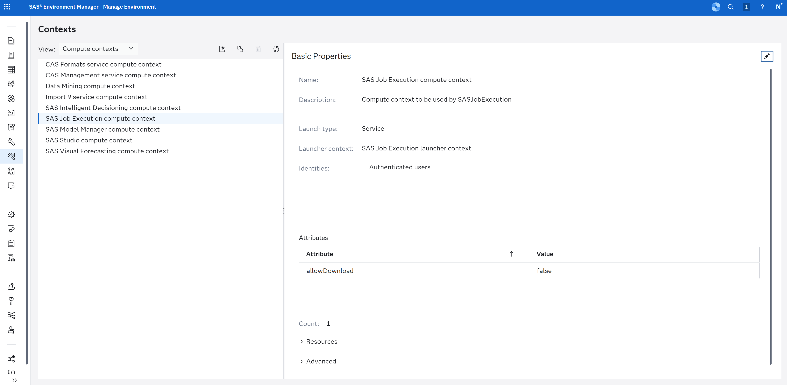

# SAS Viya Connection Profile

## Profile Anatomy

A SAS Viya connection profile includes the following parameters:

`"connectionType": "rest"`

| Name           | Description                                                           | Additional Notes                                                                                                                                           |
| -------------- | --------------------------------------------------------------------- | ---------------------------------------------------------------------------------------------------------------------------------------------------------- |
| `endpoint`     | URL for the SAS Viya server. An example is `https://example.sas.com`. | Appears when hovering over the status bar.                                                                                                                 |
| `context`      | Context for Compute Server                                            | Please see [SAS Documentation](https://go.documentation.sas.com/doc/en/sasadmincdc/default/evfun/p1dkdadd9rkbmdn1fpv562l2p5vy.htm) for more information.   |
| `clientId`     | Registered Client ID for SAS Viya                                     | Please contact your SAS administrator. `authorization_code` and `refresh_token` grant types are required.<br /> _Leave blank for Viya4 2022.11 and later._ |
| `clientSecret` | Registered Client Secret for SAS Viya                                 | Please contact your SAS administrator.<br /> _Leave blank for Viya4 2022.11 and later._                                                                    |

Depending on your SAS Viya version, the values for the prompts differ slightly.

- For SAS Viya 2022.11 and later, you can leave Client ID and Client Secret prompts empty and simply press Enter. (The built-in Client ID `vscode` will be used.)

- For SAS Viya 2022.10 and before (including SAS Viya 3.5), you need to provide a Client ID and secret.

For more information about Client IDs and the authentication process, please see the blog post [Authentication to SAS Viya: a couple of approaches](https://blogs.sas.com/content/sgf/2021/09/24/authentication-to-sas-viya/). A SAS administrator can follow the Steps 1 and 2 in the post to register a new client.

## Sign In with Posit Workbench

When running in Posit Workbench with a SAS Viya OAuth integration configured by your administrator, the extension can use the SAS Viya token that Posit Workbench already manages for you, so you do not sign in to SAS Viya a second time. Your administrator sets this up as a custom OAuth integration in Posit Workbench, and you sign in to it once from the Posit Workbench homepage (Managed Credentials).

Two optional profile settings control this:

| Name                   | Description                                                           | Additional Notes                                                                                        |
| ---------------------- | --------------------------------------------------------------------- | ------------------------------------------------------------------------------------------------------- |
| `authentication`       | How to sign in to SAS Viya: `"auto"`, `"workbench"`, or `"sasLogon"`. | Defaults to `"auto"`.                                                                                   |
| `workbenchIntegration` | GUID of the Posit Workbench OAuth integration to use.                 | Only needed when several integrations point at the same SAS Viya server. Ask your administrator for it. |

- `"auto"`: in Posit Workbench, use the OAuth integration whose token URL is the `SASLogon/oauth/token` URL of `endpoint` (or the integration set in `workbenchIntegration`). If you have not signed in to that integration yet, a message asks you to sign in to it in Posit Workbench, with the option to sign in with SAS Logon instead. Outside Posit Workbench, or when no integration matches, the extension signs in with SAS Logon as before.
- `"workbench"`: always use the Posit Workbench OAuth integration. If none is available, connecting fails with an error that explains why.
- `"sasLogon"`: always sign in with SAS Logon in the browser.

With a Posit Workbench token, the extension keeps the token in memory only and gets a fresh one from Posit Workbench before it expires. Signing out from the Accounts menu stops the extension from using the token until you sign in again; it does not sign you out of the integration in Posit Workbench.

```json
{
  "connectionType": "rest",
  "endpoint": "https://example.sas.com",
  "authentication": "auto"
}
```

## Context Properties

In Viya environments, SAS Administrators have the option to specify the `allowDownload` property on the context definition for the SAS Compute Server. This property determines the appearance of the `Download` menu item in these areas:

- Tables in the Libraries pane.

- Files and folders in the SAS Content and SAS Server panes.

- The Results pane.

The following screenshot provides an example context definition setup:


