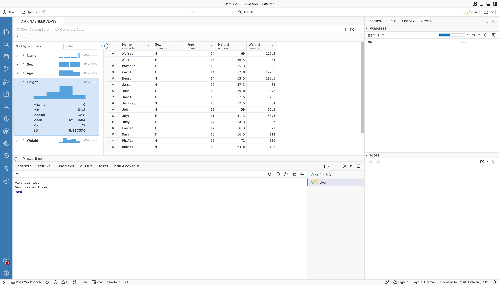
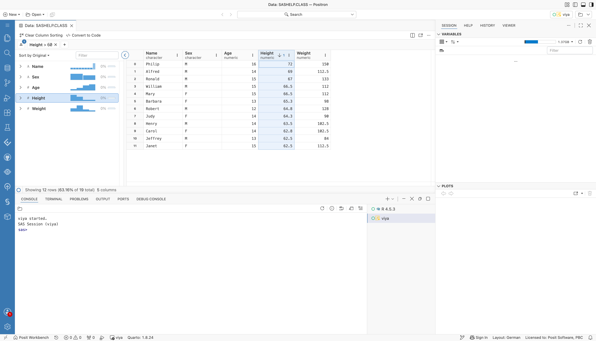
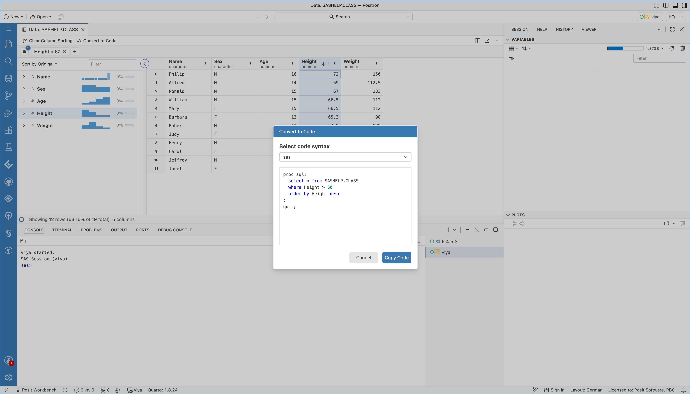
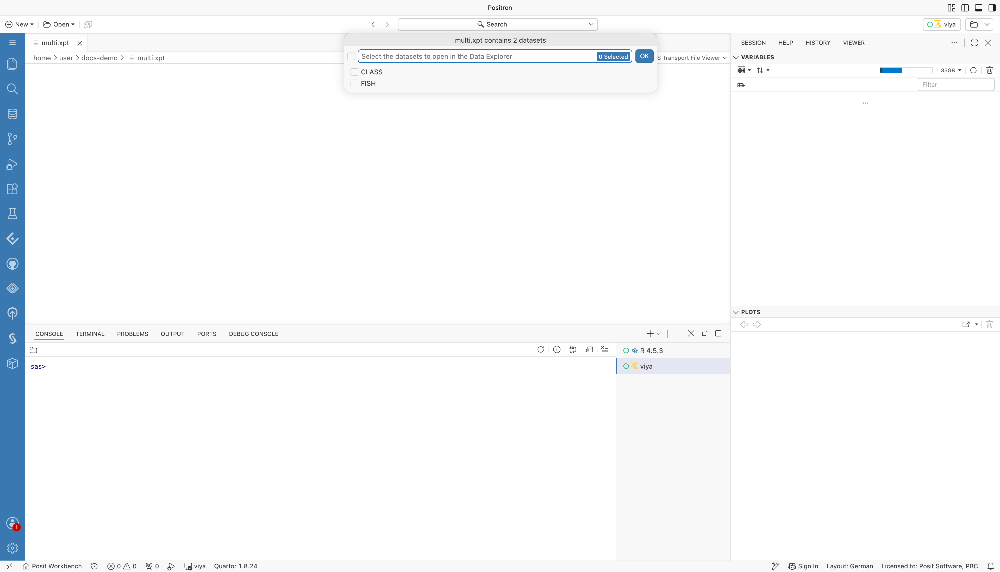

# Positron SAS Extension Features

The Positron SAS extension adds SAS to Positron as a language with its own console. SAS code runs in that console, and its results go to the usual Positron panes: the Viewer, the Plots pane, the Data Explorer, and the Connections pane. Posit Assistant can see the results and explore SAS data.

The extension works with SAS Viya, with SAS 9.4 or SAS Analytics Pro over SSH, and with a local SAS installation. Some features depend on the connection type. See [Features by Connection Type](#features-by-connection-type) for details.

:::info Builds on the SAS Extension for Visual Studio Code

The SAS Extension for Positron extends the SAS Extension for Visual Studio Code, so the rest of this documentation still applies in Positron. Connection profiles, code editing features such as syntax highlighting, completion, snippets, and folding, [SAS Content](./accessContent.md), [SAS Server](./accessServer.md), [libraries](./accessLibraries.md), and [SAS notebooks](./sasNotebook.md) work as described there. This page covers what Positron adds or changes. To run SAS in Posit Workbench, see [SAS with Posit Workbench](../Workbench/index.md).

:::

## SAS Console

Each entry in the `SAS.connectionProfiles` setting becomes a runtime named **SAS (*profile*)** in the Positron interpreter picker. [Configuring the SAS Extension](../Configurations/index.md) describes how to create profiles. In Positron, the commands described in [Running SAS Code](./running.md) and [Fixing Errors and Warnings](./errorsWarnings.md) send code to the SAS console, and results open in the Viewer pane instead of a Result tab.

- **Start a console:** pick a SAS runtime in the interpreter picker. When a `.sas` file becomes the active editor and no SAS console runs, Positron starts the preferred SAS runtime.
- **Run code from the editor:** **Run All SAS Code**, **Run Selected or All SAS Code**, and **Run Region** send the code to the SAS console, as Positron does for R and Python.
- **Run code in the console:** type SAS code at the `sas>` prompt. A statement is complete when it ends with a semicolon.
- **Read the log:** the console shows the full SAS log of your code: the source, notes, warnings, and errors. Lines from the code that the extension wraps around yours are hidden. The same lines go to the **SAS Log** output channel.
- **Find problems:** for code run from a `.sas` file, errors and warnings from the log appear as squiggles in the editor and in the **Problems** pane. The `SAS.problems.log.enabled` setting turns this off. Code typed into the console or generated by Posit Assistant reports problems in the console only.
- **See a summary:** a run with errors ends with a **SAS Error** message that lists the error lines. A run with only warnings ends with a warning count.
- **Interrupt:** the console interrupt button cancels the running code on SAS Viya. Over SSH and stdio, SAS cannot cancel a submission: the console stays busy until the code finishes, and a message offers **Restart Session**, which stops SAS.

Each console connects with the profile of the runtime you picked, and each console has its own SAS session. You can run several SAS consoles side by side, for example local SAS and SAS Viya, and shutting one down does not affect the others. The Data Explorer, the SAS data file viewers, and Posit Assistant work with the console in the foreground.

## SAS Viya Sign-In

In Posit Workbench, a SAS Viya profile signs in with the token of a Workbench OAuth integration for SAS Viya, so users sign in to SAS Viya once, on the Workbench homepage. Without a matching integration, or outside Workbench, the extension signs in with SAS Logon in the browser. The profile settings `authentication` and `workbenchIntegration` control this. See [Remote SAS Viya](../Workbench/Positron/remoteViya.md).

## Results in the Viewer and Plots Pane

The extension wraps each submission in SAS Output Delivery System (ODS) HTML5 output, with graphs drawn as inline PNG images.

- **Viewer:** each run's HTML report opens in the **Viewer** pane as a file named `sas-output-<n>.html`. In Positron builds that cannot open HTML files in the Viewer, the report opens in a **SAS Output** panel.
- **Plots pane:** each graph also goes to the **Plots** pane. The Plots pane opens after the report, so a run with graphs ends with the plot in front.
- **Text copy for Posit Assistant:** each run's result also carries a plain-text copy of the report, with titles and tables. The console shows only a short note that names the panes with the output.

If your code opens its own ODS HTML or HTML5 destination, the extension does not add its own ODS statements.

## Data Explorer

SAS datasets and views open in the Positron **Data Explorer**. Open one from the **Connections** pane, the **Data Connections** pane, or a `.sas7bdat` or `.xpt` file. The Data Explorer runs its queries as SAS code in the console session.

The following screenshot shows `SASHELP.CLASS`, opened from the **Data Connections** pane of a SAS Viya console. Right-click a table and choose **Open in Data Explorer**. The summary panel on the left lists the columns with a histogram and the share of missing values for each. The grid on the right shows the rows.


*The Data Connections pane next to the Data Explorer for SASHELP.CLASS. The summary panel lists the five columns, and the grid shows the rows.*

- **Sorting:** sort by one or more columns.
- **Row filters:** compare (`=`, `!=`, `<`, `<=`, `>`, `>=`), between, not between, is missing, is not missing, is empty, is not empty, is true, is false, set membership, and text search. Text search supports contains, does not contain, starts with, ends with, and regular expression match, with or without case sensitivity.
- **Column profiles:** missing-value counts, summary statistics, histograms for numeric columns, and frequency tables.
- **Dates:** numeric columns with a SAS date format (for example `DATE9.` or `YYMMDD10.`) are date columns. Columns with `DATETIME` or `DATEAMPM` formats are datetime columns. Positron offers date-range filters for both.
- **Convert to Code:** creates a `PROC SQL` query that selects the dataset with the current filters and sort order.

Expand a column in the summary panel to see its profile. This one shows the **Height** column of `SASHELP.CLASS`, with its histogram, the number of missing values, and summary statistics.



*The Data Explorer with the Height column expanded in the summary panel. It shows a histogram and the missing count, minimum, median, mean, maximum, and standard deviation.*

Sort and filter from the column menu or the filter bar. The next screenshot sorts **Height** in descending order and keeps the rows where `Height > 60`. The status line shows that 12 of the 19 rows remain.



*The Data Explorer with Height sorted in descending order and the filter Height greater than 60. The status line shows 12 rows of 19.*

**Convert to Code** turns the current filters and sort order into code. The dialog offers the syntax to use, and here it shows the `PROC SQL` query for the view above. **Copy Code** copies it to the clipboard.



*The Convert to Code dialog with the code syntax sas, showing a PROC SQL query that selects from SASHELP.CLASS where Height is greater than 60, ordered by Height descending.*

The Data Explorer refreshes its row counts after each console run.

## Connections

The extension lists the libraries of the running SAS session in Positron. Which pane it uses depends on the Positron version.

- **Connections pane:** in Positron 2026.09 and earlier, or when the Positron setting `dataConnections.enabled` is off, a **SAS (*profile*)** connection appears in the **Connections** pane. It shows libraries, their tables and views, and the columns with their types. Select the preview icon of a table to open it in the Data Explorer. The tree refreshes after each console run.
- **Data Connections pane:** in Positron 2026.10 and later with the Positron setting `dataConnections.enabled` turned on, the **Data Connections** pane lists a **SAS (*profile*)** connection for each running SAS console. It shows the same library tree, and preview opens a table in the Data Explorer. Positron reads `dataConnections.enabled` at startup, so restart Positron after you change it.
- **SAS Server Files:** on SAS Viya, a read-only **SAS Server Files (*profile*)** connection browses the file system of the compute session. The `fileNavigationRoot` and `fileNavigationCustomRootPath` profile settings set its root folder. In the **Data Connections** pane, text files up to 512 KB show their content in the details view. In the **Connections** pane, previewing a file opens it in an editor.

The Libraries view that [Accessing Libraries and Tables](./accessLibraries.md) describes is hidden in Positron, because the Connections and Data Connections panes replace it. On SAS Viya, the **SAS Content** and **SAS Server** views stay in the **SAS** sidebar, as described in [Accessing SAS Content](./accessContent.md) and [Accessing SAS Server](./accessServer.md).


*The SAS sidebar on SAS Viya with the SAS Content view expanded. It lists the folders Jobs and Flows, Model Repositories, Products, Public, and Users.*


*The SAS sidebar on SAS Viya with the SAS Server view expanded to the Home folder of the compute session.*

## SAS Data Files

The extension opens `.sas7bdat` and `.xpt` files in the Data Explorer. Open the file from the **Explorer**, or from a view such as the **Clinical Repository**.

- **Datasets:** for a `.sas7bdat` file on disk, the extension assigns a library to the file's folder with a `LIBNAME` statement.
- **Transport files:** for an `.xpt` file, the extension detects the format from the file header: XPORT version 5, XPORT version 8 or 9, or `PROC CPORT`. It unpacks the file into a library in the WORK folder of the session.
- **Several datasets:** when a transport file holds more than one dataset, a picker asks which ones to open.
- **Files from other views:** files that are not on disk, such as files from the **Clinical Repository** or **SAS Content** views, are copied into the WORK folder first. This copy also works when SAS runs in lockdown mode.


*The file class.sas7bdat opened in the Data Explorer through a SAS (viya) console. The extension assigned the library _FVIEW to the file's folder.*



*The dataset picker for a transport file with two datasets, CLASS and FISH.*

:::warning

SAS data files open through the SAS session, so a SAS console must run first. For files on disk, SAS reads the path itself, so the SAS server must be able to see the same path.

:::

## Posit Assistant

The extension gives Posit Assistant access to the SAS session and its results.

- **Language model tools:**
  - `sas_list_libraries` lists the libraries of the session.
  - `sas_list_tables` lists the datasets and views in a library.
  - `sas_describe_table` returns the columns, types, lengths, formats, and row count of a dataset.
  - `sas_export_saspy_config` returns the active profile as a saspy configuration, for SAS code chunks in Quarto documents with the sasquatch R package. Posit Assistant uses the commands below instead.
- **Commands for Quarto reports:**
  - **SAS: Export saspy Configuration** writes the active profile as `sascfg_personal.py`, next to the open `.qmd` file or in the workspace folder. It never asks before replacing a different file: it keeps the old one as `sascfg_personal.py.old-<timestamp>` next to it and tells you where. For a SAS Viya profile, the file uses saspy's HTTP access method and looks for the access token each time saspy connects: the `SAS_VIYA_TOKEN` environment variable, a variable on the Python main module, the Workbench OAuth integration (with posit-sdk and the integration ID), and then the token file. The file never contains secrets. See [SAS Viya with OAuth Tokens](../Workbench/Code/viyaOauth.md#r-with-sasquatch).
  - **SAS: Save Viya Token for saspy** writes the access token of the extension's SAS Viya sign-in, including a Posit Workbench token, to `~/.positron-sas/viya-token.json`. Only you can read the file. Run it again when the token has expired.
- **Workspace context:** while a SAS console runs, the assistant knows the active profile and how to use the tools above.
- **Results:** the assistant reads the text copy of each result and looks at graphs in the **Plots** pane.
- **`sas-results` skill:** in Positron 2026.10 and later, a skill tells the assistant where SAS output goes and how to read the report in the **Viewer**. The first time the assistant uses the skill, Positron asks whether it may load it. Choose **Allow**.
- **`sas-quarto-report` skill:** a skill for turning a SAS analysis into a Quarto report. See [Reports with Posit Assistant](#reports-with-posit-assistant). Positron asks whether the assistant may load it, as for the `sas-results` skill.


*Posit Assistant asking whether it can use the sas-results skill. The conversation shows the question and the getPlot and skill steps, with Allow and Decline buttons.*

As an example, ask about a result. After a console run that produced a plot, the assistant looks at the plot in the **Plots** pane and describes it. In this answer, it describes the direction, shape, and spread of the points, notes that it read the values by eye, and suggests `PROC CORR` and `PROC REG` to measure the relationship.


*Posit Assistant describing a scatter plot of weight against height from a SAS run. The answer lists the direction, shape, spread, extremes, and outliers, and suggests a follow-up with PROC CORR and PROC REG.*

### Reports with Posit Assistant

Ask Posit Assistant for a report after a SAS analysis, for example with the `/report` command, and it writes a Quarto document that keeps the analysis in SAS. It does not ask whether to use R with haven or Python with pandas. The document has `{sas}` code chunks that run through the sasquatch R package.

Before it proposes an outline, the assistant checks the setup:

1. **sasquatch:** if the package is not installed, the assistant asks whether to install it.
2. **saspy:** if the Python package is missing, the assistant offers to run `sasquatch::install_saspy()`.
3. **Connection file:** the assistant runs **SAS: Export saspy Configuration**, unless `sascfg_personal.py` already exists next to the document.

For a SAS Viya profile, the assistant also runs **SAS: Save Viya Token for saspy** before each render when the `SAS_VIYA_TOKEN` environment variable is not set, so the render uses your existing sign-in.

A SAS report follows these rules:

- **Setup chunk first:** the first code chunk is an `{r}` chunk labeled `setup`, with `library(sasquatch)` and `sas_connect()`. With only `{sas}` chunks, Quarto looks for a SAS Jupyter kernel and fails.
- **Chunk options:** in a `{sas}` chunk, options are written `*| label: load-data;`. The `#|` form that `{r}` chunks use stops the render. Leave one blank line between the last `*|` line and the first SAS statement: without it, only the first option is read.
- **Own SAS session:** the render opens its own SAS session through saspy, not your console session. Tables in `WORK` and macro variables from the console do not exist there. The report loads its data from permanent libraries or files, or repeats the DATA steps.
- **Formats:** `{sas}` chunks produce HTML and PDF output only.

Before the assistant says a report is done, it checks the `{sas}` chunks against these rules and renders the document. If it could not render, it says "Written, not rendered" and gives the reason.

The skill is part of the extension and works in Positron 2026.10 and later. In older versions, ask for the same steps by hand.

## Traceability

The extension records who ran which SAS code, including code that Posit Assistant runs.

- **Audit log:** set `SAS.audit.logFile` to a file path to record every console submission as JSON Lines. A leading `~` expands to the home folder. Leave the setting empty to turn auditing off.
  - An `input` record holds `ts`, `executionId`, `code`, `osUser`, `host`, `positronSessionId`, `profile`, `connectionType`, and, when known, `sasUser`, `workbenchServerUrl`, and `workbenchSessionId`.
  - A `complete` record holds `ts`, `positronSessionId`, `executionId`, `status` (`ok` or `error`), `errorCount`, `warningCount`, and `durationMs`.
- **Submission comment:** the first line of each submission carries a comment that SAS writes to its log. The console hides it.

  ```sas
  /* positron: user=<user> session=<session> exec=<execution> */
  ```

- **Macro variables:** each session sets `&POSIT_USER`, `&POSIT_SESSION`, and `&POSIT_WORKBENCH_SESSION`, so programs and autoexec files can reference them. `&POSIT_WORKBENCH_SESSION` is empty outside Posit Workbench.
- **SAS Viya tags:** compute sessions are named `Positron SAS (<user>)` and carry the user, host, and session IDs as attributes. Each console job is named `positron-console`, and its description holds the user, session, and execution IDs.

An example `audit.jsonl` with one submission:

```json
{"event":"input","ts":"2026-11-02T10:15:00.000Z","osUser":"jdoe","host":"pwb-1","positronSessionId":"1a2b3c4d","profile":"local","connectionType":"stdio","executionId":"e7f8","code":"proc means data=sashelp.class; run;"}
{"event":"complete","ts":"2026-11-02T10:15:01.200Z","positronSessionId":"1a2b3c4d","executionId":"e7f8","status":"ok","errorCount":0,"warningCount":0,"durationMs":1200}
```

## SAS Clinical Acceleration

On SAS Viya servers with SAS Clinical Acceleration, the **Clinical Acceleration** sidebar, next to the **SAS** one in the activity bar, shows the **Clinical Repository**, **Clinical Workspace**, **Clinical Repository Properties**, and **Clinical Version History** views. They let you browse the repository, edit files in your workspace, check files out and in, manage versions, and compare files and versions. The extension detects the service of the active profile's server and uses the existing SAS Viya sign-in. See [SAS Clinical Acceleration](./clinicalAcceleration.md) for details.

## Local SAS

The `stdio` connection type runs a SAS installation on the same machine as Positron, without SSH or SAS servers. The extension starts SAS as a child process in line mode (`-nodms`) and keeps it running for the session.

To set up a profile, run **SAS: Add New Connection Profile**, select **SAS 9.4 (local - stdio)**, and enter the path of the SAS executable. The [stdio connection profile](../Configurations/Profiles/sas9stdio.md) lists all settings.

```json
{
  "SAS.connectionProfiles": {
    "activeProfile": "local",
    "profiles": {
      "local": {
        "connectionType": "stdio",
        "saspath": "/opt/sas/viya/home/SASFoundation/sas"
      }
    }
  }
}
```

When the extension finds SAS on the machine, it adds a `local` profile like the one above. It looks in the paths of the `SAS.localSasPaths` setting, then at `/opt/sas/viya/home/SASFoundation/sas` (SAS Analytics Pro), then in common SAS 9.4 locations, where it uses the UTF-8 launcher `bin/sas_u8`, and finally for `sas` on the `PATH`. See [SAS Installed with Workbench](../Workbench/Positron/localInstalled.md). It adds the profile once: a deleted profile stays deleted, and an existing `stdio` profile prevents it. The profile becomes the active profile only if no profile is active.

The profile's `autoExec` lines run once, right after SAS starts.

## Features by Connection Type

| Feature | SAS Viya (`rest`) | SAS 9.4 or SAS Analytics Pro over SSH (`ssh`) | Local SAS (`stdio`) |
|---|---|---|---|
| SAS console and editor runs | Yes | Yes | Yes |
| Log in the console and **SAS Log** channel | Yes | Yes | Yes |
| Editor squiggles and **Problems** pane | Yes | Yes | Yes |
| Interrupt running code | Yes | No, restart to stop | No, restart to stop |
| HTML report in the **Viewer** | Yes | Yes | Yes |
| Graphs in the **Plots** pane | Yes | Yes | Yes |
| Libraries in the **Connections** or **Data Connections** pane | Yes | Yes | Yes |
| **SAS Server Files** connection | Yes | No | No |
| **Data Explorer** | Yes | Yes | Yes |
| `.sas7bdat` and `.xpt` files on disk | If the server sees the path | If the server sees the path | Yes |
| `.sas7bdat` and `.xpt` files from other views | Yes | No | No |
| Posit Assistant tools, context, and skill | Yes | Yes | Yes |
| Audit log, submission comment, and macro variables | Yes | Yes | Yes |
| Compute session and job tags | Yes | No | No |
| Sign-in through a Workbench OAuth integration | Yes | No | No |
| **SAS Content** and **SAS Server** views | Yes | No | No |
| Clinical Acceleration views | With SAS Clinical Acceleration | No | No |
| Automatic `local` profile | No | No | Yes, for SAS Analytics Pro and SAS 9.4 |

## Known Limitations

- **Interrupt over SSH and stdio:** these connection types cannot cancel running code. To stop it, restart the session.
- **Several SAS Viya servers:** consoles that connect to different SAS Viya servers at the same time are not supported.
- **Sidebar views:** the **SAS Content** and **SAS Server** views and SAS notebooks use a separate session of the active profile, not a console's session. With stdio, that starts one more SAS process.
- **No reconnect:** SAS sessions do not survive a reload of the Positron window. Positron discards them, and you start a new console.
- **Data Explorer:** exporting a selection, searching the column list, and column filters are not supported.
- **Plots:** SAS draws each graph once, so the Plots pane cannot redraw it at a new size.
- **Viewer for Posit Assistant:** the assistant can read the report in the **Viewer** only in Positron 2026.10 and later.
