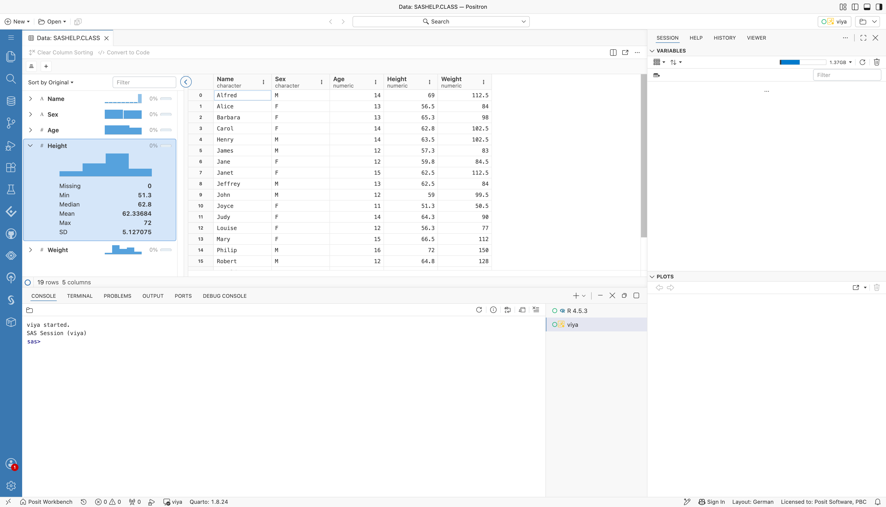
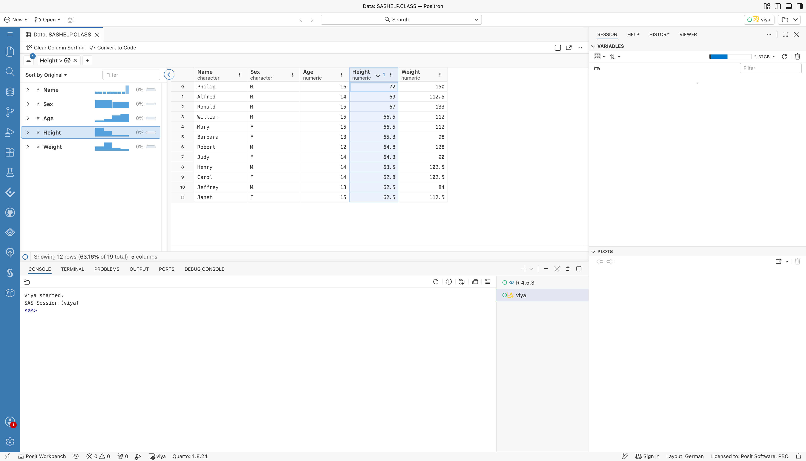
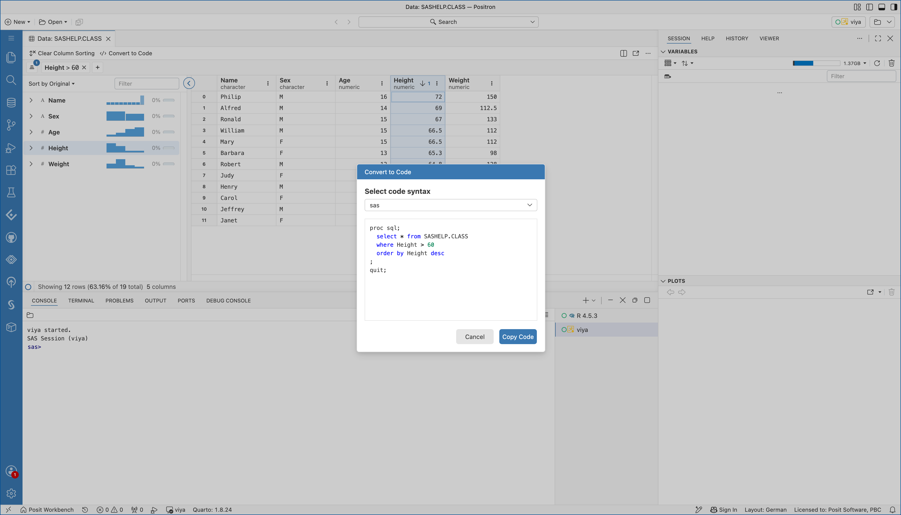
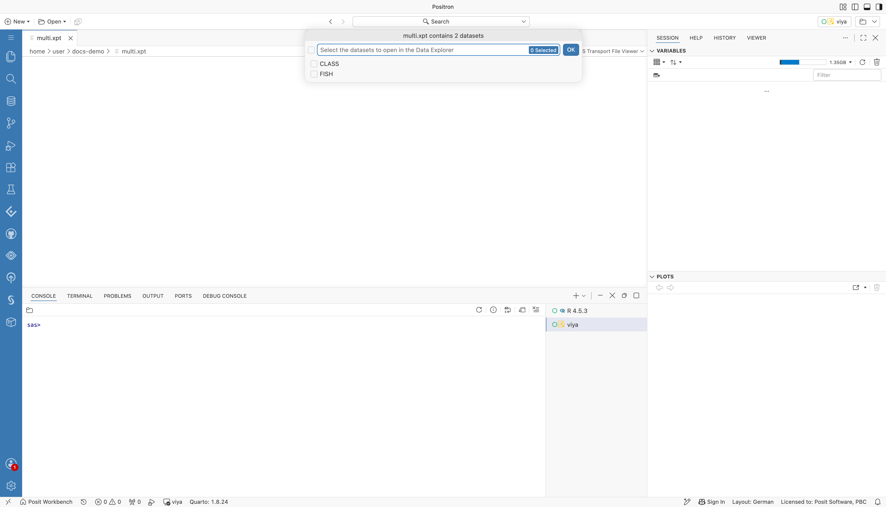

# Positron SAS Extension Features

The Positron SAS extension adds SAS to Positron as a language with its own console. SAS code runs in that console, and its results go to the usual Positron panes: the Viewer, the Plots pane, the Data Explorer, and the Connections pane. Posit Assistant can see the results and explore SAS data.

The extension works with SAS Viya, with SAS 9.4 or SAS Analytics Pro over SSH, and with a local SAS installation. Some features depend on the connection type. See [Features by Connection Type](#features-by-connection-type) for details.

To see these features in action, watch the [demo videos](../videos.mdx#positron) for SAS Analytics Pro and SAS Viya.

:::info Builds on the SAS Extension for Visual Studio Code

The SAS Extension for Positron extends the SAS Extension for Visual Studio Code, so the rest of this documentation still applies in Positron. Connection profiles, code editing features such as syntax highlighting, completion, snippets, and folding, [SAS Content](./accessContent.md), [SAS Server](./accessServer.md), [libraries](./accessLibraries.md), and [SAS notebooks](./sasNotebook.md) work as described there. This page covers what Positron adds or changes. To run SAS in Posit Workbench, see [SAS with Posit Workbench](../Workbench/index.md).

:::

## SAS Console

Each entry in the `SAS.connectionProfiles` setting becomes a runtime named **SAS (*profile*)** in the Positron interpreter picker. [Configuring the SAS Extension](../Configurations/index.md) describes how to create profiles. In Positron, the commands described in [Running SAS Code](./running.md) and [Fixing Errors and Warnings](./errorsWarnings.md) send code to the SAS console, and results open in the Viewer pane instead of a Result tab.

- **Start a console:** pick a SAS runtime in the interpreter picker. When a `.sas` file becomes the active editor and no SAS console runs, Positron starts the preferred SAS runtime.
- **Run code from the editor:** **Run All SAS Code**, **Run Selected or All SAS Code**, and **Run Region** send the code to the SAS console, as Positron does for R and Python.
- **Run code in the console:** type SAS code at the `sas>` prompt. A statement is complete when it ends with a semicolon.
- **Read the log:** the console shows the full SAS log of your code: the source, notes, warnings, and errors. Lines from the code that the extension wraps around yours are hidden. The same lines go to the **SAS Log** output channel.
- **Filter the log:** to see less of the log in the console, select the filter icon in the title bar of the **Console** pane, or run **SAS: Choose Console Log Output** from the Command Palette, and pick the parts to show: **Source**, **Notes** (NOTE lines and other log text), **Warnings**, and **Errors**. For example, pick only **Errors** and **Warnings** to keep the console short. The choice is saved in the `SAS.console.logOutput` setting and applies from the next run: output already in the console doesn't change, so to see the hidden lines of an earlier run, open the **SAS Log** output channel. While part of the log is hidden, the filter icon is filled. Whatever you pick, the console shows the error summary with the Posit Assistant actions and the number of warnings, and the **SAS Log** output channel keeps the full log.
- **Choose the compute context (SAS Viya):** a SAS console on SAS Viya runs in a compute context, and its name shows it: the console tab and the header of **Console Information** read, for example, **Viya · SAS Studio**, and the console prints the full name when it starts, such as `SAS Session (Viya), compute context "SAS Studio compute context"`. To use another one, select the server icon in the title bar of the **Console** pane, or run **SAS: Choose Compute Context...** from the Command Palette, and pick a compute context. The choice is saved as the `context` of the connection profile, so SAS notebooks, the **SAS Content** and **SAS Server** views, new consoles, and background jobs (unless `SAS.backgroundJobs.computeContext` is set) use it. A running console keeps the compute context it started with, even when you restart it: a message offers **Restart Now**, which replaces the console with a new one in the new compute context. Replacing it loses the WORK library and macro variables. A profile with a `serverId` connects to a running server and has no compute context to choose.
- **Find problems:** for code run from a `.sas` file, errors and warnings from the log appear as squiggles in the editor and in the **Problems** pane. The `SAS.problems.log.enabled` setting turns this off. Code typed into the console or generated by Posit Assistant reports problems in the console only.
- **See a summary:** a run with errors ends with a **SAS Error** message that lists the error lines. A run with only warnings ends with a warning count.
- **Interrupt:** the console interrupt button cancels the running code on SAS Viya. Over SSH and stdio, SAS cannot cancel a submission: the console stays busy until the code finishes, and a message offers **Restart Session**, which stops SAS.

Each console connects with the profile of the runtime you picked, and each console has its own SAS session. You can run several SAS consoles side by side, for example local SAS and SAS Viya, and shutting one down does not affect the others. The Data Explorer, the SAS data file viewers, and Posit Assistant work with the console in the foreground.

## SAS Viya Sign-In

In Posit Workbench, a SAS Viya profile signs in with the token of a Workbench OAuth integration for SAS Viya, so users sign in to SAS Viya once, on the Workbench homepage. Without a matching integration, or outside Workbench, the extension signs in with SAS Logon in the browser. The profile settings `authentication` and `workbenchIntegration` control this. See [Remote SAS Viya](../Workbench/Positron/remoteViya.md).

## Results in the Viewer and Plots Pane

The extension wraps each submission in SAS Output Delivery System (ODS) HTML5 output, with graphs drawn as inline PNG images.

- **Viewer:** each run's HTML report opens in the **Viewer** pane as a file named `sas-output-<n>.html`. In Positron builds that cannot open HTML files in the Viewer, the report opens in a **SAS Output** panel.
- **Plots pane:** each graph also goes to the **Plots** pane. The Plots pane opens after the report, so a run with graphs ends with the plot in front.
- **Text copy for Posit Assistant:** each run's result also carries a plain-text copy of the report, with titles and tables. The console shows only a short note that names the panes with the output.

If your code opens its own ODS HTML or HTML5 destination, the extension does not add its own ODS statements.

## Data Explorer

SAS datasets and views open in the Positron **Data Explorer**. Open one from the **Connections** pane, the **Data Connections** pane, or a `.sas7bdat` or `.xpt` file. The Data Explorer runs its queries as SAS code in the console session.

The following screenshot shows `SASHELP.CLASS`, opened from the **Data Connections** pane of a SAS Viya console. Right-click a table and choose **Open in Data Explorer**. The summary panel on the left lists the columns with a histogram and the share of missing values for each. The grid on the right shows the rows.


*The Data Connections pane next to the Data Explorer for SASHELP.CLASS. The summary panel lists the five columns, and the grid shows the rows.*

- **Sorting:** sort by one or more columns.
- **Row filters:** compare (`=`, `!=`, `<`, `<=`, `>`, `>=`), between, not between, is missing, is not missing, is empty, is not empty, is true, is false, set membership, and text search. Text search supports contains, does not contain, starts with, ends with, and regular expression match, with or without case sensitivity.
- **Column profiles:** missing-value counts, summary statistics, histograms for numeric columns, and frequency tables.
- **Column labels:** hover over a column name, in the summary panel or the grid, to see the column's SAS label.
- **Side by side:** each dataset opens in its own Data Explorer tab, so you can open several at once. To see two next to each other, drag one tab to the side of the editor, or right-click the tab and choose **Split Right** and close the original. Each Data Explorer scrolls, sorts, and filters on its own: Positron doesn't synchronize scrolling between them.
- **Compare:** **Compare with Another Dataset...** in the editor title bar compares the dataset with another one with `PROC COMPARE`. See [Comparing Datasets](./compareDatasets.md).
- **Dataset properties:** **Dataset Properties** (the info icon) in the editor title bar shows the properties of the dataset in the **Viewer**, like the table properties of SAS Studio. See [Dataset properties](#dataset-properties).
- **Dates:** numeric columns with a SAS date format (for example `DATE9.` or `YYMMDD10.`) are date columns. Columns with `DATETIME` or `DATEAMPM` formats are datetime columns. Positron offers date-range filters for both.
- **Convert to Code:** creates a `PROC SQL` query that selects the dataset with the current filters and sort order.

Expand a column in the summary panel to see its profile. This one shows the **Height** column of `SASHELP.CLASS`, with its histogram, the number of missing values, and summary statistics.



*The Data Explorer with the Height column expanded in the summary panel. It shows a histogram and the missing count, minimum, median, mean, maximum, and standard deviation.*

Sort and filter from the column menu or the filter bar. The next screenshot sorts **Height** in descending order and keeps the rows where `Height > 60`. The status line shows that 12 of the 19 rows remain.



*The Data Explorer with Height sorted in descending order and the filter Height greater than 60. The status line shows 12 rows of 19.*

**Convert to Code** turns the current filters and sort order into code. The dialog offers the syntax to use, and here it shows the `PROC SQL` query for the view above. **Copy Code** copies it to the clipboard.



*The Convert to Code dialog with the code syntax sas, showing a PROC SQL query that selects from SASHELP.CLASS where Height is greater than 60, ordered by Height descending.*

The Data Explorer refreshes after each console run that changes its dataset: when the dataset's modification time, number of rows, or number of columns changed. If the columns changed, the summary panel reloads, and the sort order and filters are cleared, because they can refer to columns that no longer exist. A Data Explorer of a view reloads after every console run, because SAS doesn't record when a view's data changes.

Each query the Data Explorer sends is a round trip to the SAS session, which on SAS Viya is several requests to the server. To keep these few, opening a dataset reads its columns, its number of rows, and the first 50 rows in one query, and the grid reads rows in blocks of 50 that it keeps while you scroll. The summary panel's statistics are computed after the rows the grid is waiting for. When you sort or filter, the query that reads the first rows also saves the sorted and filtered rows in a WORK table named `_SASDV`*n*, so that scrolling doesn't sort the whole dataset again for each page. The **Variables** and **Connections** panes don't list these tables, and the Data Explorer deletes its table when you change the sort or filter or close the Data Explorer.

### Dataset properties

The properties of a dataset are what SAS records about it in `DICTIONARY.TABLES` and `DICTIONARY.COLUMNS`:

- **Dataset:** the label, the number of rows and deleted rows, the number of columns, the row length, the file size, the creation and modification times, the variables it is sorted by, the compression, the encoding, and the data representation.
- **Columns:** the number, name, type, length, format, informat, and label of each column.

To see them:

- **Data Explorer:** select **Dataset Properties** in the editor title bar.
- **Command Palette:** run **SAS: Dataset Properties** and pick a dataset. When a SAS Data Explorer is in front, its dataset is used.
- **Explorer:** right-click a `.sas7bdat` or `.xpt` file and select **Show Dataset Properties**.
- **Data Connections pane:** select a table or view. The details editor shows the properties, and the columns as a table. Before Positron 2026.11, the columns are shown as text.

The first three show the properties as a page in the **Viewer**, which Posit Assistant can read.

## Connections

The extension lists the libraries of the running SAS session in Positron. Which pane it uses depends on the Positron version.

- **Connections pane:** in Positron 2026.09 and earlier, or when the Positron setting `dataConnections.enabled` is off, a **SAS (*profile*)** connection appears in the **Connections** pane. It shows libraries, their tables and views, and the columns with their types. Select the preview icon of a table to open it in the Data Explorer. The tree refreshes after each console run.
- **Data Connections pane:** in Positron 2026.10 and later with the Positron setting `dataConnections.enabled` turned on, the **Data Connections** pane lists a **SAS (*profile*)** connection for each running SAS console. It shows the same library tree, and preview opens a table in the Data Explorer. Select a table or view to see its [properties](#dataset-properties) in the details editor. Positron reads `dataConnections.enabled` at startup, so restart Positron after you change it.
- **SAS Server Files:** on SAS Viya, a read-only **SAS Server Files (*profile*)** connection browses the file system of the compute session. The `fileNavigationRoot` and `fileNavigationCustomRootPath` profile settings set its root folder. In the **Data Connections** pane, text files up to 512 KB show their content in the details view. In the **Connections** pane, previewing a file opens it in an editor. In both panes, `.sas7bdat`, `.sas7bvew`, and `.xpt` files open in the **Data Explorer** with the preview button: the session reads datasets and views where they are, through a library on their folder, and unpacks transport files into WORK.

The Libraries view that [Accessing Libraries and Tables](./accessLibraries.md) describes is hidden in Positron, because the Connections and Data Connections panes replace it. On SAS Viya, the **SAS Content** and **SAS Server** views stay in the **SAS** sidebar, as described in [Accessing SAS Content](./accessContent.md) and [Accessing SAS Server](./accessServer.md).


*The SAS sidebar on SAS Viya with the SAS Content view expanded. It lists the folders Jobs and Flows, Model Repositories, Products, Public, and Users.*


*The SAS sidebar on SAS Viya with the SAS Server view expanded to the Home folder of the compute session.*

## Variables Pane

The **Variables** pane shows the state of the SAS session: its macro variables and its WORK datasets. It works like the SAS Enterprise Guide macro variable viewer, and it updates after each console run. Changed entries are highlighted.

- **Your macro variables:** each GLOBAL macro variable your code sets is listed with its value. The type column shows **macro variable**. Values longer than 1,000 characters are cut off in the pane, but copying gets the whole value.
- **Startup macro variables:** the GLOBAL variables the session already had when it started, such as `&POSIT_USER` and the ones your autoexec sets, are grouped under **Startup macro variables**. Expand it to see them. When your code gives one of them a new value, it moves out of the group and is listed with your own.
- **Automatic macro variables:** the AUTOMATIC variables, such as `&SYSERR`, `&SYSLAST`, and `&SYSDATE9`, are grouped under **Automatic macro variables**. Expand it to see them.
- **WORK datasets and views:** each one is listed as **WORK.*name*** with its number of observations and variables, and its label. Expand it to see the columns with their types, lengths, formats, and labels. Select the table icon to open it in the Data Explorer.
- **Copy:** copying a macro variable gives a `%let` statement that recreates it, for example `%let cutoff=10;`. Copying a dataset gives its name.
- **Filter:** type in the filter box to find variables by name.
- **Delete all:** the **Delete all objects** button deletes your GLOBAL macro variables and the WORK datasets, after asking. It keeps the startup macro variables, the `POSIT_*` variables that identify the session, and `_SASPROGRAMFILE`.

The pane doesn't show local macro variables. They exist only while their macro runs.

On SAS Viya, the extension reads the session through the Compute API, without running SAS code. On other connection types, it runs a short hidden query after each run. That query resets `&SYSERR` and the other step-level automatic variables, but the pane shows them as your code left them, because the query reads them first. To turn the pane off for SAS, set `SAS.variablesPane.enabled` to `false`.

### Evaluate a macro expression

Select **SAS: Evaluate Macro Expression...** in the Command Palette, or the variable icon in the title bar of the **Variables** pane. Enter anything that can follow `%let name=`, such as `%eval(&n + 1)` or `%sysfunc(today(), date9.)`. A message shows the result, with any warnings or errors from the log, and **Copy Value** copies it. The expression can't contain a semicolon, and its quotes and parentheses must be balanced.

## SAS Data Files

The extension opens `.sas7bdat` and `.xpt` files in the Data Explorer through the SAS session. In the **Explorer**, right-click the file and select **Open with SAS**. Files opened from a view such as the **Clinical Repository** or **SAS Content** open this way too.

Double-clicking a file in the **Explorer** depends on the Positron version:

- **Positron 2026.12 and later, with a SAS session running:** the file opens through the SAS session. Positron opens it in its own Data Explorer first, and the extension then reopens it through SAS, so Positron's tab shows briefly and a large file takes longer to open.
- **Positron 2026.12 and later, without a SAS session:** the file opens in Positron's own Data Explorer, which reads it without SAS. Positron downloads its reader the first time; the `dataExplorer.fileReaders` setting turns it off. Its reader shows no SAS formats, can't read `PROC CPORT` files, and reads only the first dataset of a transport file with several: open those with **Open with SAS**.
- **Earlier versions,** or when an administrator turned Positron's reader off for the file type: the file opens through the SAS session.

To always use Positron's own Data Explorer on a double-click, even with a SAS session running, set `SAS.dataFiles.openWith` to `positron`.

To always open the files through the SAS session, without Positron reading them first, make the extension's viewers the default in the `settings.json` file:

```json
"workbench.editorAssociations": {
  "*.sas7bdat": "sas.sas7bdatViewer",
  "*.xpt": "sas.xptViewer"
}
```

When no SAS session is running, a file opened through the SAS session goes to Positron's own Data Explorer if Positron can read it. Otherwise, a message offers **Start SAS Session**, and the file opens once the session is up.

- **Datasets:** for a `.sas7bdat` file on disk, the extension assigns a library to the file's folder with a `LIBNAME` statement. Each folder gets its own library, `_FVIEW1`, `_FVIEW2`, and so on, so files from different folders can be open at the same time. When SAS runs on a server that can't see the folder, such as SAS Viya without shared storage, the extension copies the file into the WORK folder instead.
- **Transport files:** for an `.xpt` file, the extension detects the format from the file header: XPORT version 5, XPORT version 8 or 9, or `PROC CPORT`. It unpacks the file into a library in the WORK folder of the session. When SAS can't see the file, it copies the file into the WORK folder first.
- **Several datasets:** when a transport file holds more than one dataset, a picker asks which ones to open.
- **Files from other views:** files that are not on disk, such as files from the **Clinical Repository** or **SAS Content** views, are copied into the WORK folder first. This copy also works when SAS runs in lockdown mode.


*The file class.sas7bdat opened in the Data Explorer through a SAS (viya) console. The extension assigned a library to the file's folder. The screenshot is from an earlier version, which named it _FVIEW; it is now _FVIEW1 for the first folder.*



*The dataset picker for a transport file with two datasets, CLASS and FISH.*

:::warning

SAS data files open through the SAS session, so a SAS console must run first. For files on disk, SAS reads the path itself, so the SAS server must be able to see the same path.

:::

## Posit Assistant

The extension gives Posit Assistant access to the SAS session and its results.

- **Language model tools:**
  - `sas_list_libraries` lists the libraries of the session.
  - `sas_list_tables` lists the datasets and views in a library.
  - `sas_describe_table` returns the columns, types, lengths, formats, and row count of a dataset.
  - `sas_export_saspy_config` returns the active profile as a saspy configuration, for SAS code chunks in Quarto documents with the sasquatch R package. Posit Assistant uses the commands below instead.
- **Commands for Quarto reports:**
  - **SAS: Export saspy Configuration** writes the active profile as `sascfg_personal.py`, next to the open `.qmd` file or in the workspace folder. It never asks before replacing a different file: it keeps the old one as `sascfg_personal.py.old-<timestamp>` next to it and tells you where. For a SAS Viya profile, the file uses saspy's HTTP access method and looks for the access token each time saspy connects: the `SAS_VIYA_TOKEN` environment variable, a variable on the Python main module, on Posit Connect the content's OAuth integration (a Viewer integration with the viewer's session token that the app passes on, or a Service Account integration), the Workbench OAuth integration (with posit-sdk; without an integration ID, the one whose token URL is the server's SAS Logon token URL), and then the token file. A token without a user, such as a Service Account integration's, runs in the compute context `Posit Connect compute context`. The same file therefore renders in Workbench and on Connect. The file never contains secrets. See [SAS Viya with OAuth Tokens](../Workbench/Code/viyaOauth.md#r-with-sasquatch).
  - **SAS: Save Viya Token for saspy** writes the access token of the extension's SAS Viya sign-in, including a Posit Workbench token, to `~/.positron-sas/viya-token.json`. Only you can read the file. Run it again when the token has expired.

  

- **Workspace context:** while a SAS console runs, the assistant knows the active profile and how to use the tools above.
- **Session variables:** the assistant sees the macro variables and WORK datasets in the [Variables pane](#variables-pane), as it sees R and Python variables.
- **Results:** the assistant reads the text copy of each result and looks at graphs in the **Plots** pane.
- **`sas-results` skill:** in Positron 2026.10 and later, a skill tells the assistant where SAS output goes and how to read the report in the **Viewer**. The first time the assistant uses the skill, Positron asks whether it may load it. Choose **Allow**.
- **`sas-quarto-report` skill:** a skill for turning a SAS analysis into a Quarto report. See [Reports with Posit Assistant](#reports-with-posit-assistant). Positron asks whether the assistant may load it, as for the `sas-results` skill.


*Posit Assistant asking whether it can use the sas-results skill. The conversation shows the question and the getPlot and skill steps, with Allow and Decline buttons.*

As an example, ask about a result. After a console run that produced a plot, the assistant looks at the plot in the **Plots** pane and describes it. In this answer, it describes the direction, shape, and spread of the points, notes that it read the values by eye, and suggests `PROC CORR` and `PROC REG` to measure the relationship.


*Posit Assistant describing a scatter plot of weight against height from a SAS run. The answer lists the direction, shape, spread, extremes, and outliers, and suggests a follow-up with PROC CORR and PROC REG.*

### Reports with Posit Assistant

Ask Posit Assistant for a report after a SAS analysis, for example with the `/report` command, and it writes a Quarto document that keeps the analysis in SAS. It does not ask whether to use R with haven or Python with pandas. The document has `{sas}` code chunks that run through the sasquatch R package.

Before it proposes an outline, the assistant checks the setup:

1. **sasquatch:** if the package is not installed, the assistant asks whether to install it.
2. **saspy:** if the Python package is missing, the assistant offers to run `sasquatch::install_saspy()`.
3. **Connection file:** the assistant runs **SAS: Export saspy Configuration**, unless `sascfg_personal.py` already exists next to the document.

For a SAS Viya profile, the assistant also runs **SAS: Save Viya Token for saspy** before each render when the `SAS_VIYA_TOKEN` environment variable is not set, so the render uses your existing sign-in.

A SAS report follows these rules:

- **Setup chunk first:** the first code chunk is an `{r}` chunk labeled `setup`, with `library(sasquatch)` and `sas_connect()`. With only `{sas}` chunks, Quarto looks for a SAS Jupyter kernel and fails.
- **Chunk options:** in a `{sas}` chunk, options are written `*| label: load-data;`. The `#|` form that `{r}` chunks use stops the render. Leave one blank line between the last `*|` line and the first SAS statement: without it, only the first option is read.
- **Own SAS session:** the render opens its own SAS session through saspy, not your console session. Tables in `WORK` and macro variables from the console do not exist there. The report loads its data from permanent libraries or files, or repeats the DATA steps.
- **Formats:** `{sas}` chunks produce HTML and PDF output only.
- **Syntax highlighting:** the `setup` chunk also has the lines from [Syntax Highlighting in Rendered Documents](#syntax-highlighting-in-rendered-documents), so that the SAS code in the report is highlighted.

Before the assistant says a report is done, it checks the `{sas}` chunks against these rules and renders the document. If it could not render, it says "Written, not rendered" and gives the reason.

The skill is part of the extension and works in Positron 2026.10 and later. In older versions, ask for the same steps by hand.

### Other Coding Agents

Coding agents that work outside Positron, such as Claude Code, connect to Positron through its MCP server. Its session tools only reach Python and R sessions, so the extension adds Positron commands that let an agent use the SAS console instead of starting its own SAS session with saspy ([#156](https://github.com/posit-dev/positron-sas-extension/issues/156)):

- **`SAS.agent.listSessions`** lists the running SAS consoles with their profile and connection type, and marks the one in the foreground. It also lists the connection profiles a new console can use.
- **`SAS.agent.startConsole`** starts a SAS console with the active profile, or with the profile the agent names, if none is running. The agent should ask you first, and the agent itself usually asks you to allow the command. Starting works as when you start the console yourself: for SAS Viya you may have to sign in, and for SSH you may have to enter a password. The console is yours and stays open.
- **`SAS.agent.runCode`** runs SAS code in the foreground SAS console, or in the console the agent names. The code and its log appear in the console as if you had typed them, and the code uses your WORK tables, librefs, and macro variables. The agent gets back the log as the console shows it and the text copy of the report. Reports still go to the **Viewer** and graphs to the **Plots** pane. A very long log is cut in the middle.

To use them:

1. Turn on the `ai.mcp.enabled` setting.
2. Run **Positron MCP: Add to Coding Agent** from the Command Palette and pick your agent.
3. Start a SAS console, or let the agent start one with `SAS.agent.startConsole`. Without a console, `SAS.agent.runCode` tells the agent to ask you first.

The agent finds the commands when it searches the Positron commands for SAS. To make sure it uses them, add a line such as "Run SAS code with the Positron command `SAS.agent.runCode`, not with saspy" to the agent's instructions file, for example `CLAUDE.md` or `AGENTS.md`.

The console log filter applies to the log the agent gets, too. If you hide notes in the console, the agent doesn't see them either. The commands need Positron 2026.11 or later.

## SAS Chunks in Quarto Documents

In a Quarto document with `{sas}` code chunks, as the sasquatch R package uses, you can run single chunks in the SAS console, the same way you run `{r}` and `{python}` chunks. Above each `{sas}` chunk are **Run Cell**, **Run Next Cell**, and **Run Above**. The Command Palette also has **SAS: Run Quarto SAS Cell**, **SAS: Run Selection or Quarto SAS Cell**, and **SAS: Run Quarto SAS Cells Below**.

The log goes to the console and the results to the **Viewer**, as for a `.sas` file. If no SAS console is running, one starts. Leading `*|` chunk-option lines are not sent. **Run Above** and **Run Next Cell** cover `{sas}` chunks only; run `{r}` chunks with Quarto's own lenses.

Quarto's own shortcuts do nothing in a `{sas}` chunk, and an extension cannot override them. To run `{sas}` chunks with the same keys, add this to your `keybindings.json` (**Preferences: Open Keyboard Shortcuts (JSON)**). Use `ctrl` instead of `cmd` on Windows and Linux:

```json
[
  {
    "key": "cmd+shift+enter",
    "command": "SAS.quarto.runCell",
    "when": "editorTextFocus && editorLangId == quarto && SAS.inQuartoSasCell"
  },
  {
    "key": "cmd+enter",
    "command": "SAS.quarto.runCurrent",
    "when": "editorTextFocus && editorLangId == quarto && SAS.inQuartoSasCell"
  }
]
```

These lenses and commands fill a gap in the Quarto extension, which runs only R, Python, Julia, and C# cells. A change proposed to Quarto ([quarto-dev/quarto#1237](https://github.com/quarto-dev/quarto/pull/1237)) lets it run cells of any language that has a Positron runtime, `{sas}` included, with its own lenses and shortcuts. The extension declares its SAS runtime for that, so Quarto can find it before any connection profile exists. Once a Quarto release includes the change, the extension's lenses step aside for that version, so each chunk shows one **Run Cell**.

The console is not the SAS session that a render uses: sasquatch opens its own through saspy (see [Reports with Posit Assistant](#reports-with-posit-assistant)). Tables you create in `WORK` from the console are not there when the document renders, and data passed with `sas_from_r()` in an `{r}` chunk is not in the console.

### Syntax Highlighting in Rendered Documents

In a rendered document, the code of `{r}` chunks is highlighted, but the code of `{sas}` chunks is plain text. There are two causes:

- sasquatch (version 0.1.3) labels the code of `{sas}` chunks as plain text (`txt`), not as SAS.
- Quarto 1.11 and earlier use a Pandoc version that cannot highlight SAS. Quarto 1.12 and later can. The status bar shows the Quarto version that Positron uses.

To highlight SAS code, add these lines to the `setup` chunk, after `library(sasquatch)`. They label the code of `{sas}` chunks as SAS, with plain text as the fallback, so Quarto 1.11 and earlier still show it as a code block. The chunk output stays as it is. They work for HTML and PDF output:

````r
knitr::knit_engines$set(sas = function(options) {
  out <- sasquatch::sas_engine(options)
  if (is.character(out)) gsub("```{.txt", "```{.sas .txt", out, fixed = TRUE) else out
})
````

With Quarto 1.11 or earlier, also save the SAS syntax definition [`sas.xml`](https://raw.githubusercontent.com/KDE/syntax-highlighting/e485d0b267199dbd9c8573366386acf170073725/data/syntax/sas.xml) next to the document and add it to the YAML header:

```yaml
---
title: "My report"
syntax-definitions:
  - sas.xml
---
```

Posit Assistant adds the lines to the `setup` chunk of the reports it writes (see [Reports with Posit Assistant](#reports-with-posit-assistant)). They do no harm if a later sasquatch version labels SAS code correctly itself.

## Traceability

The extension records who ran which SAS code, including code that Posit Assistant runs.

- **Audit log:** set `SAS.audit.logFile` to a file path to record every console submission as JSON Lines. A leading `~` expands to the home folder. Leave the setting empty to turn auditing off.
  - An `input` record holds `ts`, `executionId`, `code`, `osUser`, `host`, `positronSessionId`, `profile`, `connectionType`, and, when known, `sasUser`, `workbenchServerUrl`, and `workbenchSessionId`.
  - A `complete` record holds `ts`, `positronSessionId`, `executionId`, `status` (`ok` or `error`), `errorCount`, `warningCount`, and `durationMs`.
- **Submission comment:** the first line of each submission carries a comment that SAS writes to its log. The console hides it.

  ```sas
  /* positron: user=<user> session=<session> exec=<execution> */
  ```

- **Macro variables:** each session sets `&POSIT_USER`, `&POSIT_SESSION`, and `&POSIT_WORKBENCH_SESSION`, so programs and autoexec files can reference them. `&POSIT_WORKBENCH_SESSION` is empty outside Posit Workbench.
- **SAS Viya tags:** compute sessions are named `Positron SAS (<user>)` and carry the user, host, and session IDs as attributes. Each console job is named `positron-console`, and its description holds the user, session, and execution IDs.

An example `audit.jsonl` with one submission:

```json
{"event":"input","ts":"2026-11-02T10:15:00.000Z","osUser":"jdoe","host":"pwb-1","positronSessionId":"1a2b3c4d","profile":"local","connectionType":"stdio","executionId":"e7f8","code":"proc means data=sashelp.class; run;"}
{"event":"complete","ts":"2026-11-02T10:15:01.200Z","positronSessionId":"1a2b3c4d","executionId":"e7f8","status":"ok","errorCount":0,"warningCount":0,"durationMs":1200}
```

## SAS Clinical Acceleration

On SAS Viya servers with SAS Clinical Acceleration, the **Clinical Acceleration** sidebar, next to the **SAS** one in the activity bar, shows the **Clinical Repository**, **Clinical Workspace**, **Clinical Repository Properties**, and **Clinical Version History** views. They let you browse the repository, edit files in your workspace, check files out and in, manage versions, and compare files and versions. The extension detects the service of the active profile's server and uses the existing SAS Viya sign-in. See [SAS Clinical Acceleration](./clinicalAcceleration.md) for details.

## SAS Life Science Analytics Framework

When the `SAS.lsaf.url` setting (or the `SAS_LSAF_URL` environment variable) points to a SAS Life Science Analytics Framework (LSAF) server, the **LSAF** sidebar in the activity bar shows the **Repository**, **Workspace**, and **Jobs** views. They let you browse the repository, edit files in your workspace, check files out and in, and run LSAF jobs and programs with a record of each run. LSAF has its own sign-in and doesn't depend on the active SAS profile. See [SAS Life Science Analytics Framework](./lsaf.md) for details.

## Local SAS

The `stdio` connection type runs a SAS installation on the same machine as Positron, without SSH or SAS servers. The extension starts SAS as a child process in line mode (`-nodms`) and keeps it running for the session.

To set up a profile, run **SAS: Add New Connection Profile**, select **SAS 9.4 (local - stdio)**, and enter the path of the SAS executable. The [stdio connection profile](../Configurations/Profiles/sas9stdio.md) lists all settings.

```json
{
  "SAS.connectionProfiles": {
    "activeProfile": "local",
    "profiles": {
      "local": {
        "connectionType": "stdio",
        "saspath": "/opt/sas/viya/home/SASFoundation/sas"
      }
    }
  }
}
```

When the extension finds SAS on the machine, it adds a `local` profile like the one above. It looks in the paths of the `SAS.localSasPaths` setting, then at `/opt/sas/viya/home/SASFoundation/sas` (SAS Analytics Pro), then at `/opt/sas/viya/home/SASFoundation/bin/sas_u8` (SAS Viya-based installations without the `sas` script), then in common SAS 9.4 locations, where it prefers the site's `sas` script over the UTF-8 launcher `bin/sas_u8`, and finally for `sas` on the `PATH`. See [SAS Installed with Workbench](../Workbench/Positron/localInstalled.md). It adds the profile once: a deleted profile stays deleted, and an existing `stdio` profile prevents it. If there are no connection profiles at all, it adds the profile again. The profile becomes the active profile only if no profile is active. **SAS: Add Local SAS Profile** in the Command Palette adds the profile on request, and the **SAS Local Profile** channel in the **Output** pane shows why a profile was added or not.

If the extension cannot save the profile to `settings.json`, for example because Posit Workbench writes `settings.json` at the same moment when a session starts, it tries again several times over about 15 seconds. If every attempt fails, a warning offers **Retry**: if `settings.json` shows unsaved changes, save or revert it first. A profile that could not be saved is added again at the next start. Version 0.6.2 or later is needed for this; with earlier versions, the profile could be lost on the first start in a SAS Analytics Pro image.

The profile's `autoExec` lines run once, right after SAS starts.

## Features by Connection Type

| Feature | SAS Viya (`rest`) | SAS 9.4 or SAS Analytics Pro over SSH (`ssh`) | Local SAS (`stdio`) |
|---|---|---|---|
| SAS console and editor runs | Yes | Yes | Yes |
| Log in the console and **SAS Log** channel | Yes | Yes | Yes |
| Editor squiggles and **Problems** pane | Yes | Yes | Yes |
| Interrupt running code | Yes | No, restart to stop | No, restart to stop |
| HTML report in the **Viewer** | Yes | Yes | Yes |
| Graphs in the **Plots** pane | Yes | Yes | Yes |
| Libraries in the **Connections** or **Data Connections** pane | Yes | Yes | Yes |
| **SAS Server Files** connection | Yes | No | No |
| **Data Explorer** | Yes | Yes | Yes |
| Macro variables and WORK datasets in the **Variables** pane | Yes, without running SAS code | Yes | Yes |
| `.sas7bdat` and `.xpt` files on disk | Yes (copied into WORK if the server can't see the path) | Yes (copied into WORK if the server can't see the path) | Yes |
| `.sas7bdat` and `.xpt` files from other views | Yes | No | No |
| Posit Assistant tools, context, and skill | Yes | Yes | Yes |
| Audit log, submission comment, and macro variables | Yes | Yes | Yes |
| Compute session and job tags | Yes | No | No |
| Choose the console's compute context | Yes | No | No |
| Background jobs and the **Background Jobs** view | With the SAS Job Execution service | No | No |
| Sign-in through a Workbench OAuth integration | Yes | No | No |
| **SAS Content** and **SAS Server** views | Yes | No | No |
| Clinical Acceleration views | With SAS Clinical Acceleration | No | No |
| LSAF views (independent of the profile) | With an LSAF server | With an LSAF server | With an LSAF server |
| Automatic `local` profile | No | No | Yes, for SAS Analytics Pro and SAS 9.4 |

## Known Limitations

- **Interrupt over SSH and stdio:** these connection types cannot cancel running code. To stop it, restart the session.
- **Several SAS Viya servers:** consoles that connect to different SAS Viya servers at the same time are not supported.
- **Sidebar views:** the **SAS Content** and **SAS Server** views and SAS notebooks use a separate session of the active profile, not a console's session. With stdio, that starts one more SAS process.
- **No reconnect:** SAS sessions do not survive a reload of the Positron window. Positron discards them, and you start a new console.
- **Data Explorer:** exporting a selection, searching the column list, and column filters are not supported.
- **Plots:** SAS draws each graph once, so the Plots pane cannot redraw it at a new size.
- **Quarto visual editor:** the lenses and commands for `{sas}` chunks work in the source editor only. Quarto's shortcuts do nothing in a `{sas}` chunk unless you add your own (see [SAS Chunks in Quarto Documents](#sas-chunks-in-quarto-documents)).
- **Viewer for Posit Assistant:** the assistant can read the report in the **Viewer** only in Positron 2026.10 and later.
