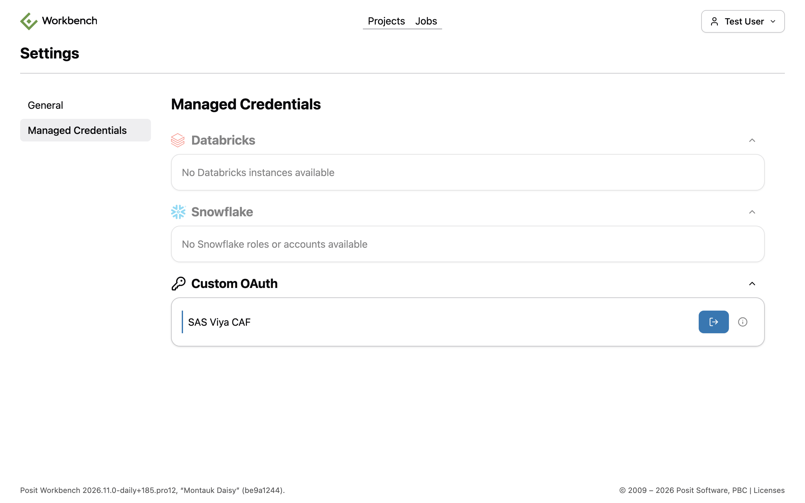
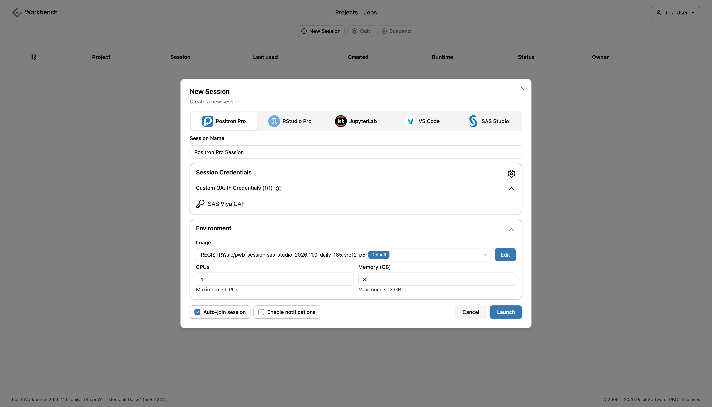

# SAS Viya with OAuth Tokens

In this variant, R and Python code sends SAS work to SAS Viya 4. Posit Workbench or Posit Connect signs the user in to SAS Logon and gives the code a SAS Viya access token. The code passes the token to saspy, swat, or sasctl and never handles a password.

For the libraries and the overall pattern, see [Scenario 3: SAS in Your R and Python Code](./index.md).

## What You Get

- No sign-in in code: users sign in to SAS Viya once in Workbench, and their code reads a short-lived token.
- The same sign-in for the Positron SAS extension: a SAS Viya console in Positron uses the same Workbench integration. See [Remote SAS Viya](../Positron/remoteViya.md).
- The user's own SAS Viya identity: SAS Compute sessions, SAS Cloud Analytic Services (CAS) sessions, and SAS Viya web service calls run with the permissions of the signed-in user.
- Token refresh in Workbench: Workbench refreshes the token when SAS Logon issues a refresh token. Code asks Workbench for a token each time it connects.
- Per-viewer access on Connect: with a Viewer integration, each viewer of a Shiny app runs SAS as themselves.
- Shared access on Connect: with a Service Account integration, rendered and scheduled content runs SAS with one shared identity.

## Requirements

- SAS Viya 4 with the Compute service, reachable over HTTPS from Workbench sessions and Connect content
- A SAS Viya administrator who can register OAuth clients in SAS Logon
- saspy for SAS Compute, swat for CAS, or sasctl for SAS Viya web services
- For Workbench:
  - Workbench with Custom OAuth integrations (a Preview feature in the Enhanced and Advanced tiers)
  - HTTPS access to Workbench, and the Job Launcher with `launcher-sessions-callback-address` set
  - RStudio Pro, Positron Pro, or VS Code sessions. Custom OAuth credentials do not reach JupyterLab sessions.
  - R: the rstudioapi package. Python: the posit-sdk package, with Workbench 2026.01.0 or later.
- For Connect:
  - OAuth integrations, which need the Enhanced or Advanced tier
  - R: the connectapi package. Python: the posit-sdk package.

## Set Up

### Register OAuth Clients in SAS Logon

Register one SAS Logon client for Workbench and another for Connect. Separate clients let SAS Viya audit logs show which product made each call.

A SAS Viya administrator registers each client with a `POST` to `https://viya.example.com/SASLogon/oauth/clients`. The request needs an administrator token with the `clients.write` scope. The following body registers the Workbench client:

```json
{
  "client_id": "posit-workbench",
  "client_secret": "CLIENT_SECRET",
  "scope": ["openid", "sas-compute.user_impersonation"],
  "authorized_grant_types": ["authorization_code", "refresh_token"],
  "redirect_uri": ["https://workbench.example.com/oauth_redirect_callback"],
  "access_token_validity": 36000,
  "refresh_token_validity": 86400,
  "autoapprove": ["openid", "sas-compute.user_impersonation"]
}
```

- `redirect_uri`: for Workbench, `https://workbench.example.com/oauth_redirect_callback`. The path is fixed and does not contain the integration name.
- `authorized_grant_types`: `authorization_code` for the sign-in, and `refresh_token` so that Workbench can renew the access token.
- `scope`: `openid` and `sas-compute.user_impersonation`.
- `autoapprove`: skips the SAS Logon consent page for these scopes.
- `access_token_validity` and `refresh_token_validity`: lifetimes in seconds. Choose values that match your security policy.

Register the Connect client the same way, with these differences:

- Use a different `client_id`, such as `posit-connect`.
- Set `redirect_uri` to `https://connect.example.com/__oauth__/integrations/callback`. If a proxy serves Connect under a path, include it, for example `https://posit.example.com/connect/__oauth__/integrations/callback`.
- For a Service Account integration, add `client_credentials` to `authorized_grant_types`. Connect Service Account integrations use the OAuth client credentials grant.

:::warning

A token from the client credentials grant identifies the OAuth client, not a person. Confirm with your SAS Viya administrator that SAS Compute accepts such a token, and which identity the Compute session runs as. SAS Compute might need a compute context that runs as a shared account.

:::

### Configure the Workbench User OAuth Provider

Add a section for SAS Viya to `/etc/rstudio/oauth-clients.conf`:

```ini
[sas-viya]
name=SAS Viya
client-id=posit-workbench
client-secret=CLIENT_SECRET
authorize-url=https://viya.example.com/SASLogon/oauth/authorize
token-url=https://viya.example.com/SASLogon/oauth/token
scopes=openid,sas-compute.user_impersonation
```

The `scopes` value is a comma-separated list. For several SAS Viya deployments, add one section for each, such as `[sas-viya]` and `[sas-viya-test]`, each with its own SAS Logon client.

The Positron SAS extension finds this integration by its `token-url`. Use the same SAS Viya host name in `token-url` as in the users' SAS Viya profiles.

Restrict the file permissions, because it contains the client secret, and reload Workbench:

```bash
sudo chmod 600 /etc/rstudio/oauth-clients.conf
sudo chown rstudio-server:rstudio-server /etc/rstudio/oauth-clients.conf
sudo rstudio-server reload
```

### Create the Connect OAuth Integrations

Create Custom OAuth integrations in Connect that point to SAS Logon. Most deployments create two integrations from the same SAS Logon client:

- **SAS Viya (Viewer):** each viewer signs in with their own SAS Viya identity. It works only with interactive content, such as Shiny apps.
- **SAS Viya (Service Account):** all viewers share one token. It works with interactive and rendered content, such as Quarto documents and scheduled reports.

An administrator creates the integrations in the Connect dashboard or through the Connect Server API. The following request body creates the Viewer integration with a `POST` to `/__api__/v1/oauth/integrations`:

```json
{
  "name": "SAS Viya (Viewer)",
  "template": "custom",
  "config": {
    "auth_type": "Viewer",
    "auth_mode": "Confidential",
    "use_pkce": true,
    "authorization_uri": "https://viya.example.com/SASLogon/oauth/authorize",
    "token_uri": "https://viya.example.com/SASLogon/oauth/token",
    "client_id": "posit-connect",
    "client_secret": "CLIENT_SECRET",
    "scopes": "openid sas-compute.user_impersonation",
    "token_endpoint_auth_method": "client_secret_post"
  }
}
```

For the Service Account integration, set `auth_type` to `Service Account` and remove `auth_mode` and `use_pkce`. Those two options apply only to Viewer integrations.

Publishers then add an integration to each content item. In the content settings, open the **Runtime** tab, and under **Integrations**, click **Add Integrations**. Rendered content offers only Service Account integrations.

## Use It

### In a Workbench Session

1. On the Workbench homepage, click your user name, then **Settings**, then **Managed Credentials**.
2. Under **Custom OAuth**, sign in to **SAS Viya**. Positron Pro and VS Code users can also sign in from the **Available Credentials** view.
3. Click the information icon next to **SAS Viya** and copy the **Integration ID**.
4. Store the ID in an environment variable, such as `SAS_VIYA_INTEGRATION_ID` in `.Renviron` or `.env`.



*The Managed Credentials page in Workbench. Under Custom OAuth, the SAS Viya integration is signed in, and its button signs the user out.*

Once you are signed in, new sessions receive the credential automatically. The **New Session** dialog lists it under **Session Credentials**, in **Custom OAuth Credentials**.



*The New Session dialog with the Custom OAuth Credentials section expanded, listing the SAS Viya integration.*

The integration ID stays the same between sessions. Code can also look it up by name with `rstudioapi::findOAuthIntegration(name = "^SAS Viya$")` in R, or `Client().oauth.integrations.find_by(name="^SAS Viya$")` in Python.

#### Python with saspy

saspy accepts a SAS Logon access token through its `authtoken` option. The `viya` definition in `sascfg_personal.py` needs only `url` and `context`:

```python
import os
import saspy
from posit.workbench import Client

creds = Client().oauth.get_credentials(audience=os.environ["SAS_VIYA_INTEGRATION_ID"])

sas = saspy.SASsession(cfgname="viya", authtoken=creds["access_token"])
print(sas.submitLOG("proc options option=work; run;"))
sas.endsas()
```

`get_credentials()` returns `None` when the user has not signed in to the integration.

#### R with sasquatch

`sas_connect()` passes only `cfgname` to saspy, so the token must come from the saspy configuration. This `sascfg_personal.py` reads the token from a variable in the Python main module each time a session starts:

```python
import __main__

SAS_config_names = ['viya']

def __getattr__(name):
    # saspy looks up the definition by name for each SASsession
    if name == 'viya':
        return {'url':       'https://viya.example.com',
                'context':   'SAS Studio compute context',
                'authtoken': getattr(__main__, 'SAS_VIYA_TOKEN', None)}
    raise AttributeError(name)
```

R code gets the token from Workbench and sets that variable on the Python main module through reticulate. `py_set_attr()` does this in one call. The shorter `reticulate::py$SAS_VIYA_TOKEN <- ...` fails in R, because R cannot assign to a name with a package prefix.

```r
library(sasquatch)

creds <- rstudioapi::getOAuthCredentials(
  audience = Sys.getenv("SAS_VIYA_INTEGRATION_ID")
)
reticulate::py_set_attr(reticulate::import_main(), "SAS_VIYA_TOKEN", creds$access_token)

sas_connect(cfgname = "viya", reconnect = TRUE)
sas_from_r(mtcars, "cars")
sas_run_string("proc means data=cars; var mpg; run;")
sas_disconnect()
```

`getOAuthCredentials()` throws an error when the user has not signed in to the integration.

The following screenshot shows the same steps in a Positron Pro session. It runs the `plot.sas` program from the [demo repository](./index.md#the-pattern-from-the-demo-repository) on SAS Viya, with `sas_run_string()`. The Viewer pane shows the plot and the table that the program creates.


*An R console in Positron running sasquatch against SAS Viya. The code gets the token from Workbench, connects, and runs a SAS program. The Viewer pane shows the plot and the listing.*

Python code can use the same `sascfg_personal.py`. An `authtoken` argument to `SASsession()` takes precedence over the configuration.

Posit Assistant in Positron can export a SAS Viya profile as a saspy configuration. That configuration reads the token from the `SAS_VIYA_TOKEN` environment variable once, when saspy loads the file. To get a fresh token for each connection, replace its `authtoken` entry with the `__main__` lookup above.

#### swat and sasctl

swat accepts the token as the `password` argument when no `username` is given. sasctl accepts it as the `token` argument:

```python
import swat
from sasctl import Session

conn = swat.CAS("https://viya.example.com/cas-shared-default-http/",
                password=creds["access_token"])
print(conn.serverstatus())

with Session("viya.example.com", token=creds["access_token"]):
    ...  # call sasctl services here
```

### In Content on Connect

The token comes from Connect instead of Workbench. Connect never gives refresh tokens to content.

| | Viewer integration | Service Account integration |
|---|---|---|
| Identity in SAS Viya | Each viewer | One shared identity |
| Content types | Interactive only, such as Shiny | Interactive and rendered, such as Quarto and R Markdown |
| Viewer sign-in | Each viewer signs in to SAS Viya on first visit | None |
| R function | `connectapi::get_oauth_credentials()` | `connectapi::get_oauth_content_credentials()` |
| Python function | `Client().oauth.get_credentials()` | `Client().oauth.get_content_credentials()` |

Use a Viewer integration when results depend on each viewer's SAS Viya permissions. Use a Service Account integration for rendered or scheduled content, and for content that all viewers may see with the same data.

#### Shiny for R with a Viewer Integration

The viewer's session token arrives in the `Posit-Connect-User-Session-Token` request header. Exchange it for the viewer's SAS Viya token:

```r
library(shiny)
library(sasquatch)

server <- function(input, output, session) {
  observeEvent(input$run_analysis, {
    user_token <- session$request$HTTP_POSIT_CONNECT_USER_SESSION_TOKEN
    creds <- connectapi::get_oauth_credentials(connectapi::connect(), user_token)
    reticulate::py_set_attr(reticulate::import_main(), "SAS_VIYA_TOKEN", creds$access_token)

    sas_connect(cfgname = "viya", reconnect = TRUE)
    # ... sas_from_r(), sas_run_string(), sas_to_r() ...
    sas_disconnect()
  })
}
```

#### Shiny for Python with a Viewer Integration

```python
import saspy
from posit.connect import Client
from shiny import App, reactive, ui

app_ui = ui.page_fluid(ui.input_action_button("run", "Run Analysis"))

def server(input, output, session):
    @reactive.effect
    @reactive.event(input.run)
    def _():
        user_token = session.http_conn.headers.get("Posit-Connect-User-Session-Token")
        creds = Client().oauth.get_credentials(user_token)
        sas = saspy.SASsession(cfgname="viya", authtoken=creds["access_token"])
        # ... sas.df2sd(), sas.submit(), sas.sd2df() ...
        sas.endsas()

app = App(app_ui, server)
```

#### Quarto and R Markdown with a Service Account Integration

Rendered content reads the content session token that Connect provides. This setup chunk works both in Workbench and on Connect:

```r
library(sasquatch)

if (Sys.getenv("POSIT_PRODUCT") == "CONNECT") {
  creds <- connectapi::get_oauth_content_credentials(connectapi::connect())
} else {
  creds <- rstudioapi::getOAuthCredentials(
    audience = Sys.getenv("SAS_VIYA_INTEGRATION_ID")
  )
}
reticulate::py_set_attr(reticulate::import_main(), "SAS_VIYA_TOKEN", creds$access_token)

sas_connect(cfgname = "viya")
```

In Python, `Client().oauth.get_content_credentials()` returns the token. If content has more than one integration, pass the integration ID as `audience` to choose one.

## Keep Tokens across Workbench Restarts

Workbench stores each user's OAuth tokens in its database, encrypted with the `secure-cookie-key`. Sessions call Workbench for a token with a cookie signed with the `session-rpc-key`. If Workbench creates new keys when it restarts, the stored tokens cannot be decrypted, and the integration shows "Custom OAuth integration 'sas-viya' has validation errors" until the user signs in again. Sessions that were running before the restart also cannot get tokens.

Keep both keys, and the launcher keys, the same across restarts:

- On a server installation, the keys in `/var/lib/rstudio-server` and `/etc/rstudio` persist on disk. For several Workbench nodes, use the same `secure-cookie-key` on every node.
- In Kubernetes with the rstudio-workbench Helm chart (checked with chart version 0.10.3), store the keys in one Kubernetes secret, with the keys `launcher.pem`, `launcher.pub`, `secure-cookie-key`, and `session-rpc-key`. Reference it with `secureCookieKey.existingSecret` and `launcherPem.existingSecret`. Add `launcher.pub` and `session-rpc-key` with `config.existingSecrets`. The chart's `secureCookieKey.value` and `launcherPem.value` settings do not mount the keys into the pod, so Workbench creates new ones on every start.

The `secure-cookie-key` must be at least 32 characters long, for example from `openssl rand -hex 32`. Workbench does not start with a shorter key.

## Limitations

- saspy uses the token for every call to the Compute service and does not renew a token that it did not request. Connect again with a fresh token when the token expires.
- sasquatch keeps one SAS session for each R process. With a Viewer integration, set **Max connections per process** to 1 for the Shiny app, so that viewers do not share a SAS session.
- Viewer integrations do not work with rendered content, anonymous public access, or share links.
- In Workbench Jobs, token retrieval stops working 7 days after the job is submitted.
- Custom OAuth credentials are not available in JupyterLab sessions.
- The access token's scopes limit what the code can do in SAS Viya. Confirm that the scopes you register permit CAS and SAS Viya web service calls before you rely on swat or sasctl.
