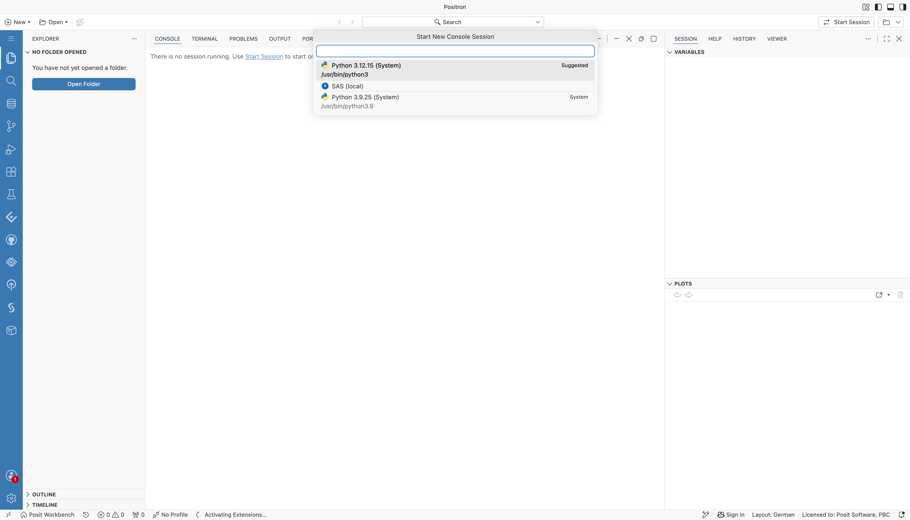
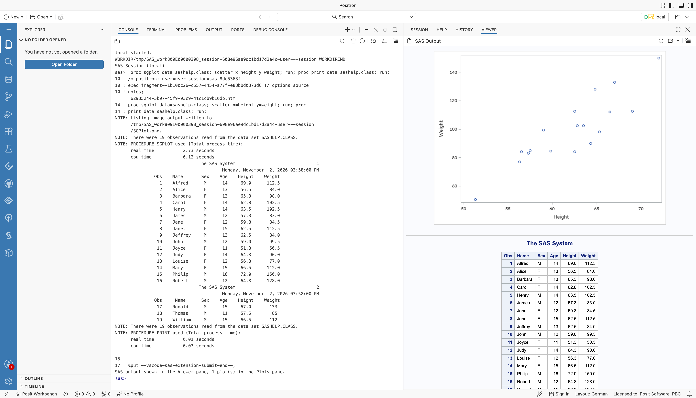

# Local SAS: SAS Analytics Pro Container

:::warning Proof of concept

This variant depends on a Workbench build with SAS Studio support, which is not part of a Workbench release.

:::

Users start a Positron session from the unmodified SAS Analytics Pro image and run SAS inside it. Posit does not require any changes to the image. The session runs as the user, not as root, and starts no SAS services. Workbench provides the license from a Kubernetes secret, and SAS is available in the SAS console and in the terminal.

## What You Get

- **Positron SAS console:** a **SAS (local)** runtime appears in the interpreter picker with no setup. It runs SAS on the session's own SAS installation through the [stdio connection](../../Configurations/Profiles/sas9stdio.md), with all the [Positron SAS extension features](../../Features/positron.md) that work with local SAS.
- **Terminal:** SAS runs from the terminal by its path in the image, as in any unmodified SAS Analytics Pro container:

  ```sh
  /opt/sas/viya/home/SASFoundation/sas -nodms     # line mode
  /opt/sas/viya/home/SASFoundation/sas prog.sas   # batch
  ```

- **Multithreading:** SAS sets `CPUCOUNT` from the session's CPU limit, so thread-enabled procedures use the CPUs chosen when starting the session.

## Requirements

- A Workbench build with SAS Studio support, with `ide-session-license=1`, and the Kubernetes Job Launcher
- An unmodified SAS Analytics Pro image that the cluster can pull, and a SAS Analytics Pro license (SETINIT)
- For the SAS console: the Positron SAS extension 0.4.0 or later

## Set Up

1. Store the license in a Kubernetes secret in the sessions namespace. The key must be `SETINIT_TEXT`:

   ```sh
   kubectl create secret generic sas-license \
     --from-literal=SETINIT_TEXT="$(cat /path/to/setinit.txt)" \
     -n <sessions-namespace>
   ```

2. Turn on licensing for IDE sessions in `/etc/rstudio/sas-studio.conf`. The image must be listed in `container-images`:

   ```ini
   container-images=REGISTRY/sas/apro:2026.10
   license-secret=sas-license
   ide-session-license=1
   ```

3. Allow the same image for Positron sessions with `container-images` in `/etc/rstudio/launcher.kubernetes.profiles.conf`.

4. If Workbench creates container users (`launcher-sessions-create-container-user=1` in `useradd` mode), start the session container of these pods as root in `job.tpl`. The image's default user is `sas`, and Workbench needs root to create the user before it switches to it. Replace the `securityContext` of the `rs-launcher-container` with:

   ```yaml
   {{- $containerSecurityContext := deepCopy ($templateData.pod.containerSecurityContext | default dict) }}
   {{- if and (contains "/sas/apro:" .Job.container.image) (not (has "rstudio-sas-studio-session" .Job.tags)) }}
     {{- $_ := set $containerSecurityContext "runAsUser" 0 }}
     {{- $_ := set $containerSecurityContext "runAsGroup" 0 }}
     {{- $_ := set $containerSecurityContext "runAsNonRoot" false }}
   {{- end }}
   {{- with $containerSecurityContext }}
   securityContext:
     {{- toYaml . | nindent 12 }}
   {{- end }}
   ```

   With the `rstudio-workbench` Helm chart, pass the modified file through `launcher.extraTemplates`. Keep the chart's `job.tpl` otherwise unchanged.

:::warning

Set root on the container, not on the pod. A pod-level `runAsUser` also applies to the init container, and the kubelet then writes projected service account tokens as files that only root can read. The session user then cannot use workload identity, for example AWS Identity and Access Management (IAM) roles for service accounts, which Posit Assistant can use for Amazon Bedrock.

:::

## How Licensing Works

When a user starts a Positron session from one of the SAS images, Workbench adds the license secret to that session's container. At session start, Workbench writes the license to a private file and sets `SASV9_OPTIONS`, which SAS reads at startup, to pass the license file and a SASUSER library in `~/sasuser.viya`. Sessions on other images do not receive the license. The session log shows `SAS license configured` when the setup succeeds.

## Use It

1. On the Workbench home page, choose **New Session**, select **Positron**, and pick the unmodified SAS Analytics Pro image.

   

   *The New Session dialog with the Positron Pro tab selected and the SAS Analytics Pro image chosen instead of the default session image.*

2. Choose **SAS (local)** in the interpreter picker, or open a `.sas` file to start the SAS console.

   

   *The Start New Console Session picker in Positron, listing SAS (local) next to the Python interpreters.*

   The SAS console runs your code. Positron shows the rendered output in the Viewer pane.

   

   *A SAS console in Positron after running PROC SGPLOT and PROC PRINT on sashelp.class. The log and listing appear in the console. The scatter plot and the formatted table appear in the Viewer pane.*

3. To limit the threads SAS uses, set `options cpucount=1;` in your program, or `nthreads=` on the `PERFORMANCE` statement of a high-performance procedure.

## Limitations

- The SAS extension's SAS Viya features (SAS Content, server files, Clinical Repository) are not available, because no SAS Viya is involved.
- The SAS Compute Server in the image is not used. See [Remote SAS over SSH](./remoteSsh.md#why-not-the-sas-compute-server-rest-endpoint).
- If a shell profile replaces `SASV9_OPTIONS`, SAS started from that shell fails with a SETINIT expiration error. Append to `SASV9_OPTIONS` instead.
- The console cannot interrupt a running submission. It stays busy until the code finishes, and a message offers to restart the session, which stops SAS.
- The session user can read the license file. Only enable `ide-session-license` for users entitled to the license.
