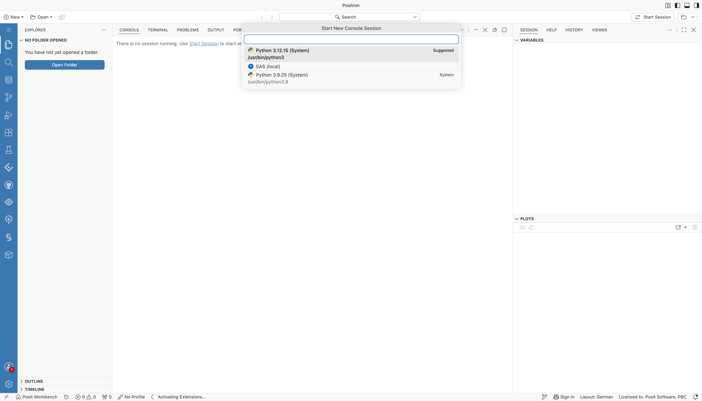
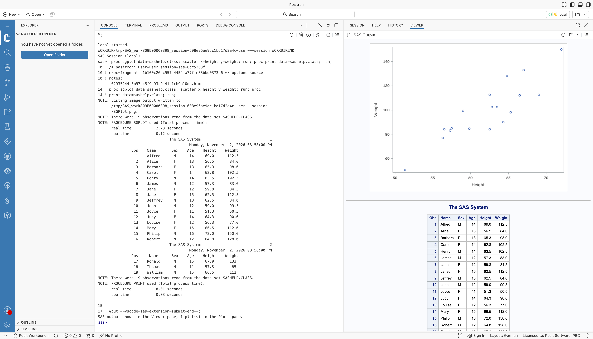

# Local SAS: SAS Installed with Workbench

An administrator installs SAS where Workbench sessions run, in the same way as R and Python: on the Workbench host for local sessions, or in the session image for container sessions. Positron then runs SAS in the session through the local (stdio) connection.

## What You Get

- SAS in the Positron console, with all the [Positron SAS extension features](../../Features/positron.md) that work with local SAS
- SAS in the terminal, by its installation path
- No SAS server and no network connection to SAS: code and data stay in the session

## Requirements

- Any Workbench release with Positron sessions
- The Positron SAS extension 0.4.0 or later. Automatic profiles for SAS 9.4 need version 0.5.0 or later.
- SAS installed and licensed on the Workbench host or in the session image. The license is applied at installation, as for any SAS installation, so Workbench does not provide it.

## Set Up

1. Install SAS on the Workbench host, or add it to the session image, and apply the SAS license.
2. Make sure that users can run the SAS launcher and write to the SAS WORK location.

## Use It

The extension adds a `local` connection profile automatically when it finds SAS. It uses the first executable launcher in this order:

1. The paths in the `SAS.localSasPaths` setting
2. `/opt/sas/viya/home/SASFoundation/sas`, the path in SAS Analytics Pro and SAS Viya-based installations
3. Common SAS 9.4 locations, such as `/opt/sas/SASHome/SASFoundation/9.4/bin/sas_u8` and `/usr/local/SASHome/SASFoundation/9.4/bin/sas_u8`
4. `sas` on the `PATH`

For SAS 9.4, the extension uses the UTF-8 launcher `bin/sas_u8`, because it reads SAS output as UTF-8. `SAS.localSasPaths` is a machine setting, so an administrator can set it for all users of a Workbench host or session image when SAS is installed elsewhere.

The extension adds the profile once: a deleted profile stays deleted, and an existing `stdio` profile prevents it. Users can also add the profile to their Positron settings themselves:

```json
"SAS.connectionProfiles": {
  "activeProfile": "local",
  "profiles": {
    "local": {
      "connectionType": "stdio",
      "saspath": "/opt/sas/SASHome/SASFoundation/9.4/bin/sas_u8"
    }
  }
}
```

Then choose **SAS (local)** in the interpreter picker, or open a `.sas` file to start the SAS console. For all profile settings, see the [stdio connection profile](../../Configurations/Profiles/sas9stdio.md).



*The Start New Console Session picker in Positron, listing SAS (local) next to the Python interpreters.*

The SAS console runs your code. Positron shows the rendered output in the Viewer pane.



*A SAS console in Positron after running PROC SGPLOT and PROC PRINT on sashelp.class. The log and listing appear in the console. The scatter plot and the formatted table appear in the Viewer pane.*

## Limitations

- Every session that runs SAS uses the session's CPUs and memory, so size sessions for SAS workloads.
- The SAS license terms apply to every machine and container that runs SAS.
- The console cannot interrupt a running submission. It stays busy until the code finishes, and a message offers to restart the session, which stops SAS.
