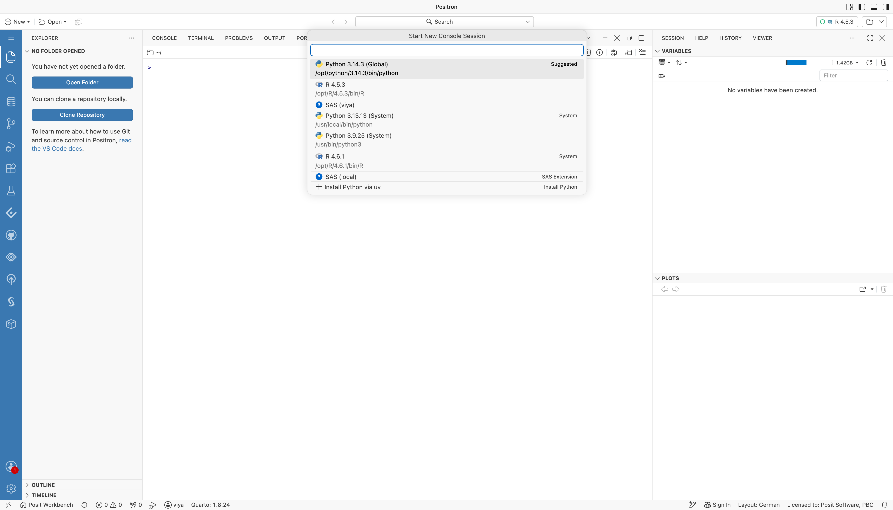
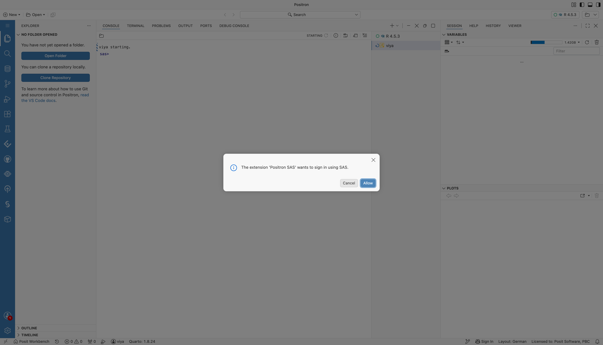
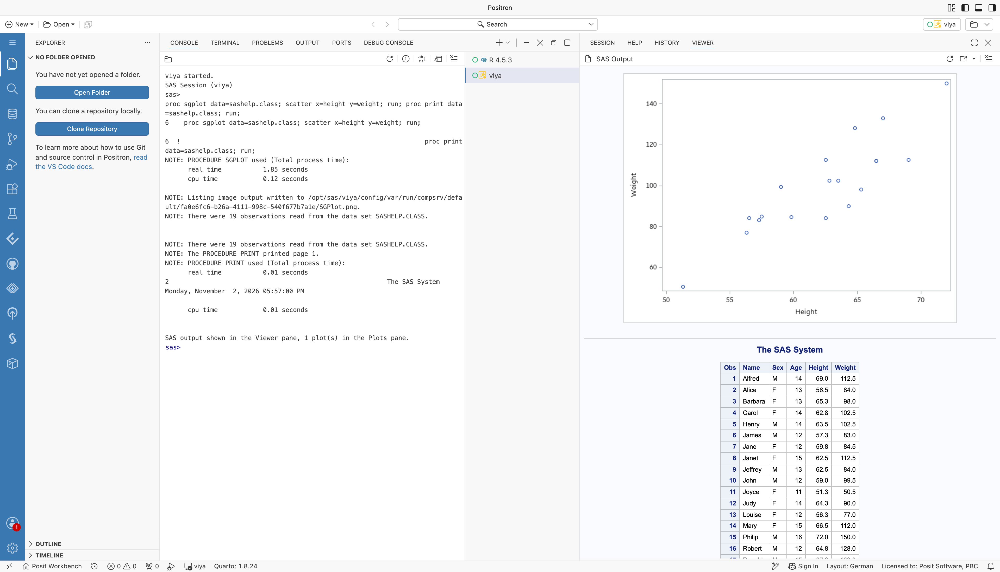

# Remote SAS Viya

Positron connects to SAS Viya over its REST APIs. SAS code runs in a SAS Viya compute session, and the extension also gives access to SAS Content, SAS server files, and, with SAS Clinical Acceleration, the Clinical Repository.

The profile settings are the ones in [SAS Viya Connection Profile](../../Configurations/Profiles/viya.md). This page shows how the pieces fit together in Posit Workbench.

## What You Get

- SAS in the Positron console on SAS Viya compute, with all the [Positron SAS extension features](../../Features/positron.md), including the ones that need SAS Viya
- One sign-in to SAS Viya: with a Workbench OAuth integration for SAS Viya, the extension uses the token that Workbench manages, the same token that [code in sessions](../Code/viyaOauth.md) uses
- SAS Viya compute sessions and jobs tagged with the Workbench user and session, for traceability in SAS Viya
- No SAS installation or license in Workbench

## Requirements

- Any Workbench release with Positron sessions
- SAS Viya, reachable from Workbench sessions
- The Positron SAS extension. Sign-in through Workbench needs version 0.5.0 or later.
- One of these ways to sign in:
  - **Through Workbench (recommended):** a custom OAuth integration for SAS Viya in Workbench, set up as in [Configure the Workbench User OAuth Provider](../Code/viyaOauth.md#configure-the-workbench-user-oauth-provider), and Positron Pro sessions
  - **With SAS Logon in the browser:** an OAuth client in SAS Logon for the extension's sign-in. SAS Viya 4 2022.11 and later have one for SAS's extension, so `clientId` can stay empty. Check that it allows the Positron SAS extension's sign-in in your environment.

## Set Up

1. For sign-in through Workbench, add the SAS Viya section to `oauth-clients.conf` as described in [Configure the Workbench User OAuth Provider](../Code/viyaOauth.md#configure-the-workbench-user-oauth-provider). The extension picks the integration whose `token-url` is `SASLogon/oauth/token` on the SAS Viya URL of the profile, so use the same host name in both.
2. Give users the SAS Viya URL. For sign-in with SAS Logon, also give them the client ID, if your SAS Viya needs one. For the client and profile settings, see the [SAS Viya connection profile](../../Configurations/Profiles/viya.md).

## Use It

1. For sign-in through Workbench, sign in to the SAS Viya integration once: on the Workbench homepage, click your user name, then **Settings**, then **Managed Credentials**, and sign in under **Custom OAuth**. Positron Pro users can also sign in from the **Available Credentials** view.
2. Add a profile to the Positron settings:

   ```json
   "SAS.connectionProfiles": {
     "activeProfile": "viya",
     "profiles": {
       "viya": {
         "connectionType": "rest",
         "endpoint": "https://viya.example.com"
       }
     }
   }
   ```

3. Choose **SAS (viya)** in the interpreter picker.

   

   *The Start New Console Session picker in Positron, listing SAS (viya) and SAS (local) with the Python and R interpreters.*

4. The first time, Positron asks whether the extension may sign in using SAS. Choose **Allow**. The extension then gets the token from Workbench, and the console starts a SAS Viya compute session.

   

   *The Positron prompt that asks whether the Positron SAS extension may sign in using SAS, with Cancel and Allow buttons.*

5. Run SAS code in the console, or open a `.sas` file. The console log shows the session on SAS Viya compute, and the results open in the Viewer pane.

   

   *The SAS console in Positron connected to SAS Viya compute. The console shows the SAS log of a PROC SGPLOT and PROC PRINT run, and the Viewer pane shows the scatter plot and the table.*

With the default `"authentication": "auto"`, the extension uses the Workbench integration when one matches the profile's `endpoint`. If you have not signed in to it yet, a message asks you to sign in in Workbench, or to sign in with SAS Logon instead. Without a matching integration, or outside Workbench, the extension opens SAS Logon in the browser.

Two profile settings change this:

- `authentication`: `"workbench"` always uses the Workbench integration and fails with an explanation if there is none. `"sasLogon"` always signs in with SAS Logon.
- `workbenchIntegration`: the ID of the integration to use, when several integrations point to the same SAS Viya. The ID is shown under the information icon next to the integration in **Managed Credentials**.

The extension keeps the Workbench token in memory and gets a new one from Workbench before it expires. Signing out in the Positron **Accounts** menu stops the extension from using the token. It does not sign you out of the integration in Workbench.

## Limitations

- Sign-in through Workbench needs a Positron Pro session, which can reach Workbench. In Positron outside Workbench, the extension signs in with SAS Logon.
- Consoles that connect to different SAS Viya servers at the same time are not supported. Consoles against the same SAS Viya server each get their own compute session.
- Workbench must keep its keys across restarts, as described in [Keep Tokens across Workbench Restarts](../Code/viyaOauth.md#keep-tokens-across-workbench-restarts).
